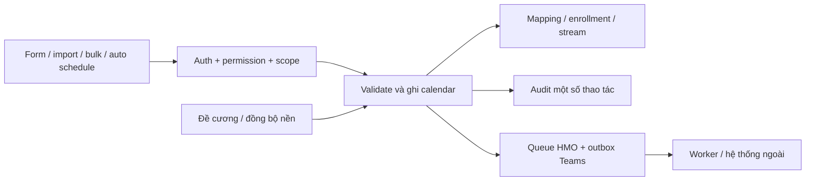
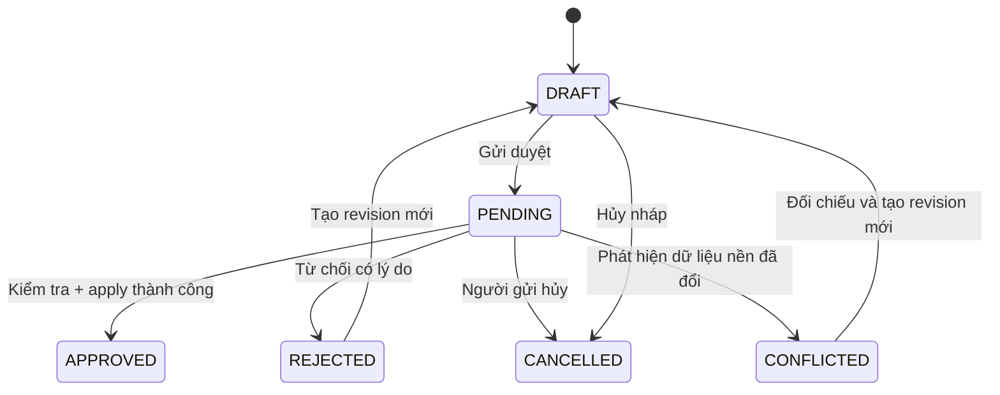

> Bổ sung Role/User policy ngày 26/11/2026: Role giữ mặc định REQUIRE/SKIP; User override INHERIT/REQUIRE/SKIP. Khi nhiều Role, REQUIRE được ưu tiên. Thiết kế cập nhật và quy tắc chuyển đổi cấu hình cũ nằm trong [tài liệu triển khai](calendar-approval-implementation.md).

> Cập nhật 26/11/2026: đã bỏ tính năng theo dõi thay đổi Sheet theo yêu cầu. Các số liệu khảo sát ban đầu dưới đây mang tính lịch sử; trạng thái triển khai hiện tại nằm trong [tài liệu triển khai](calendar-approval-implementation.md). Workflow và notification hiện chỉ phục vụ LMS.

# Quản lý lịch học trên LMS: khảo sát và thiết kế phê duyệt

- Ngày khảo sát: 26/11/2026, Asia/Ho_Chi_Minh.
- Giai đoạn: **Phase 1 — thiết kế để thống nhất trước khi code**.
- Backend khảo sát: `lms-manage-api`, nhánh `main`, HEAD `0f38b9b`.
- Frontend khảo sát: `LMS.FE`, nhánh `main`, HEAD `91bf965`.
- Database kiểm tra trực tiếp, chỉ đọc: `livestream_local`, MySQL 8.0.46.
- Tài liệu này chỉ bổ sung thiết kế; không chạy migration, seed, thay đổi lịch, gửi thông báo, đổi nhánh hoặc bật worker/tunnel.

## 1. Kết luận thiết kế

LMS đã có bảng lịch chính thức, RBAC, giới hạn theo chương trình, soft delete, audit một số thao tác và outbox Teams/Học Mãi. Không cần thay thế các thành phần này.

Đề xuất thêm lớp **yêu cầu thay đổi** đứng trước luồng ghi lịch. Bản nháp và yêu cầu chờ duyệt nằm trong các bảng riêng. Chỉ khi approve thành công mới ghi `calendar` và các bảng liên quan, tạo audit, queue đồng bộ và thông báo kết quả trong cùng transaction.

Mặc định đề xuất mọi thao tác tạo/sửa/xóa/nghỉ/dời/khôi phục lịch đều phải duyệt khi bật workflow. Chưa cấp quyền ghi trực tiếp đặc biệt cho admin; quyền `*` không tự vượt qua workflow. Việc triển khai chỉ bắt đầu sau khi thống nhất thiết kế này.

## 2. Bằng chứng và luồng hiện tại

### 2.1. Các nguồn code chính

Đường dẫn dưới đây tính từ repo tương ứng; tên hàm dùng để tra cứu khi số dòng thay đổi.

| Phần | Nguồn đã đọc | Kết quả |
|---|---|---|
| HTTP/server | Backend `src/app.ts`, `src/server.ts` | Express, `/api/livestreams` và alias `/livestreams`; server khởi động nhiều worker |
| Lịch | `src/modules/livestream/livestream.route.ts`, `.controller.ts`, `.service.ts` | Create/update hiện ghi lịch ngay; chưa có approval gate |
| Liên kết bài | `src/modules/lessons/lesson.repository.ts` | Sửa đề cương/reorder/đổi môn có SQL cập nhật lịch trực tiếp |
| Phân quyền | `src/modules/auth/auth.middleware.ts`, `src/services/authorization.service.ts` | JWT + session DB, role/permission, scope theo tài khoản |
| Quyền trường | `src/modules/roles/field-permission.service.ts` | visible/editable theo `fieldPolicy` của role |
| Schema chuẩn repo | `prisma/schema.prisma` | MySQL/Prisma; file `prisma/schema/rbac.prisma` chỉ là bản phụ, không thay schema chính |
| Queue HMO | `src/modules/livestream/hocmai-sync-queue.service.ts` | Ghi queue trong transaction, điều khiển chống trùng trigger bằng biến session |
| Teams | `src/modules/teams-notifications/*` | Outbox lưu DB, worker gửi webhook, không phải inbox chuông LMS |
| Import | `src/modules/livestream/calendar-import.service.ts` | Có đường SQL cập nhật hàng loạt riêng, không chỉ gọi `updateSchedule` |
| Livestream | `evg-stream.service.ts`, `calendar-user-sync.service.ts`, `classroom-assignment.service.ts` | Có tác động đến stream, enrollment, lớp/phòng |
| Frontend thực dùng | `app/(admin)/schedule/page.tsx`, `services/livestreamService.ts`, `hooks/useLmsQueries.ts` | Next.js/Ant Design/SWR; màn lịch gọi `/api/livestreams` |
| Form lịch | `app/(admin)/schedule/components/Modal/ScheduleModal.tsx` | Gọi API ghi trực tiếp; còn có tạo nhanh đề cương bằng `createLesson` |

`services/scheduleService.ts` ở frontend trỏ `/api/schedules` nhưng không phải service màn quản lý lịch hiện tại đang dùng. Không thiết kế approval dựa vào service này.

### 2.2. Luồng hiện tại

`createSingle`, `createBulk`, `updateSchedule`, `rescheduleSession`, `swapSessionTimes`, `deleteSession`, `restoreSession` đều là thao tác chính thức. Một số đã dùng Serializable/row lock; kiểm tra conflict của `updateSchedule` còn diễn ra trước transaction. Không thể gọi các hàm này để “lưu nháp” rồi hoàn tác.

Audit hiện có không bao phủ đồng đều mọi trường: `auditTimeChange` ghi đổi thời gian/phân công; các luồng lifecycle có log riêng. Approval cần audit cho toàn bộ chuyển trạng thái và dữ liệu đề xuất, không chỉ các trường đã có log.

### 2.3. Database local đã kiểm tra

| Hạng mục | Kết quả tại thời điểm khảo sát |
|---|---|
| Lịch | 3.772 bản ghi; 0 có `deleted_at` khác null |
| Liên kết đề cương | 643 bản ghi chưa có `session_id` |
| EVG | 295 lịch có `evg_stream` không rỗng |
| Trợ giảng | 175 lịch có `assistant_teacher` không rỗng |
| Audit cũ | 150 `calendar_change_logs` |
| Teams outbox | 1.423 bản ghi; số lượng này không khẳng định đã gửi thành công |
| Trigger | `information_schema.TRIGGERS` của database local trả về **0 trigger** |
| Múi giờ session DB | `SYSTEM`, chênh UTC +420 phút tại lần đọc |
| Migration gần nhất | `20261125000000_add_sheet_schedule_changes`, đã hoàn tất |

Schema local có các cột `calendar_source`, `waiting_video_playlist`, `group_id`, `group_room_config`, `live_ended_at`, `live_ended_by` chưa có trong model `calendar` của HEAD khảo sát. Local có migration nhóm học/phòng mà model hiện tại chưa thể hiện đầy đủ. Không chạy `db push`, reset hoặc tạo migration bằng cách mặc định local khớp schema repo.

Tệp `prisma/sql/calendar_triggers.sql` trên HEAD chứa SQL trigger đã comment. Có công cụ `db:calendar-triggers`, nhưng không được chạy trong khảo sát. Không suy luận môi trường khác cũng không có trigger: phải đọc metadata và định nghĩa trigger ở đúng môi trường đích trước rollout.

Chưa truy cập production, chưa kiểm chứng worker ngoài repo đang tiêu thụ queue HMO, cấu hình reverse proxy Socket hoặc dữ liệu môi trường khác. Các số trên chỉ mô tả local.

## 3. Dữ liệu và định danh cần bảo toàn

| Nhóm | Bảng/trường hiện tại | Quy tắc cho workflow |
|---|---|---|
| Lịch chính thức | `calendar.id` unsigned int | Định danh ổn định cho update/delete; không dùng số dòng Sheet, tên bài hoặc `key` làm ID yêu cầu |
| Đề cương | `calendar.session_id` → `lessons.id`; fallback legacy `code + learn_number` | Chấp nhận lịch cũ thiếu session; kiểm tra quyền theo chương trình hiệu lực như hiện tại |
| Slot lịch | `code`, `learn_number`, `lesson_count`, `key` | `key` unique, có quy tắc tái sử dụng lịch đã xóa; không tự sửa code/learn_number khi update |
| Thời gian | `start_time`, `end_time` Timestamp(0) | Giữ quy ước wall-clock Việt Nam; không đổi timezone toàn hệ thống trong refactor này |
| Trạng thái buổi | `lesson_status`, `cancel_reason`, `deleted_at` | Tách khỏi trạng thái approval; nghỉ, xóa mềm và reject là ba việc khác nhau |
| Nội dung/phân công | teacher, assistant, tên bài, tài liệu, phòng | Snapshot before/after có dữ liệu đã chuẩn hóa, kiểm tra quyền từng trường |
| Tích hợp | `package_lesson_mapping`, `lesson_course_mapping`, `hocmai_sync_queue` | Mapping chính thức chỉ đổi sau duyệt; worker cũng phải tham gia quy tắc concurrency |
| Livestream/lớp | `stream`, `room_config`, `users`, `classroom_assignment_history` | Không tạo/chuyển phòng, enrollment hoặc EVG cho bản nháp |
| RBAC | users, roles, permissions, user_roles, role_permissions, modules/module_fields | Tận dụng; không thêm hệ quản lý tài khoản độc lập |
| Lịch sử | `calendar_change_logs` | Giữ nguyên lịch sử cũ; bổ sung correlation với request/revision khi apply |

Ở HEAD hiện tại, nguồn `livestream/feed` được suy ra từ prefix `feed-` của `code` trong `calendar-source.ts`, dù local còn cột `calendar_source`. Cần xác minh chênh lệch này trước migration; không tự chuyển dữ liệu nguồn.

## 4. RBAC và phạm vi dữ liệu

### 4.1. Tận dụng quyền đang có

Giữ mã lưu DB dạng dấu chấm. Các tên `CALENDAR_*` trong yêu cầu là tên nghiệp vụ/enum, không cần tạo bộ quyền chữ hoa song song.

| Quyền nghiệp vụ | Mã hiện tại/đề xuất | Trạng thái |
|---|---|---|
| CALENDAR_VIEW | `calendar.view` | Đã có |
| CALENDAR_CREATE | `calendar.create` | Đã có; khi bật workflow là quyền đề xuất tạo |
| CALENDAR_EDIT | `calendar.update` | Đã có; khi bật workflow là quyền đề xuất sửa |
| CALENDAR_DELETE | `calendar.delete` | Đã có; quyền đề xuất xóa/khôi phục theo nghiệp vụ hiện tại |
| CALENDAR_SUBMIT_APPROVAL | `calendar.submit_approval` | Bổ sung |
| CALENDAR_APPROVE | `calendar.approve` | Bổ sung |
| CALENDAR_REJECT | `calendar.reject` | Bổ sung |
| CALENDAR_VIEW_APPROVAL | `calendar.approval.view` | Bổ sung cho danh sách đội duyệt |
| CALENDAR_VIEW_HISTORY | `calendar.history.view` | Bổ sung |
| Cấu hình workflow | `calendar.workflow.manage` | Bổ sung cho Schedule Admin |
| Phân công | `calendar.teacher.manage` | Giữ yêu cầu bổ sung khi thay giáo viên/trợ giảng |
| Import/export | `calendar.import`, `calendar.export` | Giữ; import tạo đề xuất khi bật workflow |

`authorize([...])` hiện là **OR**, không phải AND. Endpoint yêu cầu edit + submit phải kiểm tra cả hai bằng middleware liên tiếp hoặc service kiểm tra rõ ràng. `*`/role admin có thể vượt kiểm tra permission hiện tại, nhưng không được vượt state machine, transaction hoặc chính sách tự duyệt.

Seed hiện gán một số role bằng `startsWith('calendar.')`. Khi bổ sung quyền phải sửa thành cấp quyền có chủ đích, tránh role editor/teacher tự nhận approve/reject. Không chạy seed rộng để “cập nhật quyền” trên dữ liệu người dùng hiện có.

### 4.2. Scope thực tế

`loadUserAccess` lấy scope từ **tài khoản** (`user_program_scope_policies`, `user_program_scopes`, `scope_resources` loại `PROGRAM`), độc lập role; các mode là ALL / RESTRICTED / DENY. Các bảng role scope cũ còn tồn tại nhưng không phải căn cứ hiệu lực hiện tại. Cache quyền mặc định 30 giây, đã có hàm invalidate.

Workflow dùng cùng `assertProgramAccess`, `getProgramScopeFilter` và `FieldPermissionService`:

- Tạo: xác minh chương trình qua bài học/nguồn chuẩn, không tin `program_code` do client gửi.
- Sửa/xóa: đọc lịch rồi xác định scope; kiểm tra toàn bộ các lịch bị ảnh hưởng, cả before và after khi phù hợp.
- Bulk/swap/following: có quyền với tất cả mục; không cho duyệt một phần ngầm.
- Approver cần `calendar.approval.view` và quyền approve/reject tương ứng; không bắt buộc có quyền tạo/sửa trực tiếp như editor.
- Mọi trường thay đổi phải nằm trong phạm vi editor được chỉnh. Approver phải được xem đầy đủ các trường cần quyết định; nếu thiếu, không cho duyệt mù.
- Kiểm tra lại quyền/scope của người gửi và người duyệt ở lúc submit/approve, đọc quyền mới thay vì tin snapshot hoặc token cũ.
- Xem yêu cầu của chính mình trong scope bằng quyền thao tác + `calendar.view`; xem yêu cầu người khác cần `calendar.approval.view`. Lịch sử đầy đủ cần `calendar.history.view`.
- REST list/detail/export, count/badge, audit, notification và deep link áp dụng cùng scope. Không chỉ lọc frontend.

Hệ hiện tại chưa có scope hiệu lực riêng theo môn/lớp/hệ. Phase đầu dùng PROGRAM. Nếu cần các chiều đó, phải mở rộng nguồn resource và resolver sau thống nhất, không suy từ chuỗi tên môn.

### 4.3. Role mẫu, không gán cứng tài khoản

| Role cấu hình | Quyền gợi ý |
|---|---|
| Schedule Editor | View, create/update/delete theo nhu cầu, submit, history, quyền trường và phân công tương ứng |
| Schedule Approver | View, approval.view, approve/reject, history, quyền xem đủ trường |
| Schedule Admin | Quản lý workflow; quản lý role/user qua quyền hiện hữu được cấp riêng; không mặc định tự duyệt |

Đề xuất mặc định **không tự duyệt**, kể cả admin. Cấu hình ngoại lệ nếu nghiệp vụ yêu cầu phải được thống nhất riêng và lưu audit. Tài khoản có nhiều role vẫn chịu quy tắc này. Nếu không có approver hợp lệ trong scope, chặn submit với lỗi rõ ràng; draft vẫn lưu được.

## 5. State machine và hành vi nghiệp vụ

`CONFLICTED` là trạng thái kỹ thuật đề xuất thêm: UI ghi “Cần đối chiếu lại”. Approved chỉ được đặt nếu chính thức đã apply trong cùng transaction. Không có trạng thái “approved nhưng calendar chưa ghi”. Đồng bộ hệ thống ngoài sau commit là trạng thái tích hợp riêng, không đổi approved thành rejected.

| Thao tác | Dữ liệu lưu trước duyệt | Sau approve |
|---|---|---|
| CREATE | Bản đề xuất, chưa có calendar ID chính thức | Tạo calendar, mapping và tác động hợp lệ; lưu ID kết quả |
| UPDATE | Before chuẩn hóa + patch + after đề xuất | Ghi các trường được duyệt trên lịch còn hợp lệ |
| DELETE | Snapshot lịch, lý do xóa | Dùng soft delete hiện tại, giữ dữ liệu liên quan và audit |
| CANCEL / MAKEUP / FOLLOWING | Kế hoạch nghỉ/bù/dời và toàn bộ mục bị ảnh hưởng | Dùng nghiệp vụ lifecycle hiện có qua transaction chung |
| SWAP | Hai lịch và kết quả đổi giờ cuối cùng | Áp dụng cả hai hoặc rollback cả hai |
| RESTORE | Lịch xóa mềm và liên kết cần phục hồi | Kiểm tra key/conflict trước khôi phục theo nghiệp vụ cũ |

Quy tắc:

1. DRAFT được sửa bởi chủ sở hữu còn quyền. Không gửi cho approver mỗi lần gõ/lưu nháp; có thể đồng bộ giao diện của chủ sở hữu qua notification riêng khi cần.
2. Submit đóng băng revision. PENDING không chỉnh sửa payload; muốn đổi thì hủy và tạo revision mới.
3. Reject bắt buộc lý do có nội dung (đề xuất tối đa 1.000 ký tự). Người tạo sửa và gửi lại bằng revision mới; revision bị từ chối không bị ghi đè.
4. Cancel là hủy yêu cầu, không phải nghỉ buổi học. Request đã approved không được “hủy” để hoàn tác lịch; cần yêu cầu mới.
5. Không tạo hai submission đang active cho cùng request. Cho phép nhiều request độc lập đề xuất cùng lịch; request duyệt sau phải đối chiếu và có thể conflict.
6. Không tự động duyệt, tự merge, tự rebase hoặc tự thay bài/giờ nếu dữ liệu nền thay đổi.
7. Auto schedule/import phải materialize danh sách before/after trước submit. Không lưu công thức “dời các lịch phía sau” rồi tự chạy ra tập lịch khác khi approve.
8. Chính sách đang có: lịch đã diễn ra/đã nghỉ bị hạn chế sửa; mapping là ngoại lệ có kiểm soát. Kiểm tra lại tại approve vì thời gian đã trôi qua.
9. Với chỉnh sửa, default yêu cầu lý do nghiệp vụ; tạo mới có thể để tùy chọn. Không trộn lý do nghiệp vụ với lý do reject.

## 6. Schema đề xuất (chưa tạo migration)

Tên dưới đây là thiết kế, chưa tồn tại ở HEAD/local khảo sát.

### 6.1. `calendar_change_requests`

- `id` BIGINT UNSIGNED, `public_id` CHAR(36) unique.
- `created_by` INT UNSIGNED → người tạo, tên hiển thị snapshot cho audit.
- `status` VARCHAR(20); `current_revision_id`; `lock_version` INT để CAS cập nhật draft/chuyển trạng thái.
- `created_at`, `updated_at`, `submitted_at`, `decided_at` DATETIME(3).
- Index `(created_by,status,id)`, `(status,submitted_at,id)`.
- Không cascade xóa request/audit khi xóa hoặc vô hiệu hóa user; giữ ID/snapshot theo chính sách lưu trữ.

### 6.2. `calendar_request_revisions`

- `id`, `request_id`, `revision_no`; unique `(request_id,revision_no)`.
- `operation_type`, `reason`, `payload_schema_version`.
- `policy_version` đã dùng, `plan_hash`, `submitted_by`, `submitted_at`.
- `status`, `decided_by`, `decided_at`, `rejection_reason` cho từng revision.
- Snapshot revision sau submit bất biến; trạng thái/decision chỉ thay qua state machine, không sửa payload.

### 6.3. `calendar_request_items`

- `id`, `revision_id`, `item_no`; unique `(revision_id,item_no)`.
- `operation_type`, `calendar_id` nullable (null khi tạo), `result_calendar_id` sau apply.
- `program_code` xác định ở server và `session_id` nullable để hỗ trợ lịch legacy.
- `before_data` JSON nullable; `proposed_data` JSON nullable; `changed_fields` JSON; `patch` JSON.
- `base_fingerprint` CHAR(64); `dependency_fingerprint` CHAR(64); `scope_snapshot` JSON cho audit, không làm căn cứ cấp quyền.
- Mapping và dữ liệu nhiều mục được snapshot riêng trong cấu trúc có version; không chỉ snapshot một phần `calendar`.
- Index `(calendar_id,revision_id)`, `(program_code,revision_id)` để lọc scope.

### 6.4. `calendar_workflow_audit`

- `id`, `request_id`, `revision_id`, `transition_no`, `action`, `actor_user_id`, `actor_snapshot`, `reason`, `created_at`.
- `from_status`, `to_status`, `before_data`, `after_data`, `applied_calendar_ids`, `operation_id`.
- Unique `(request_id,transition_no)`; index `(request_id,id)`, `(actor_user_id,created_at)`.
- Append-only qua application; không cung cấp endpoint sửa/xóa. Quyền DB/retention cần chốt theo vận hành; không tuyên bố chống can thiệp tuyệt đối chỉ nhờ bảng log.
- Giữ `calendar_change_logs`; bổ sung liên kết request/revision hoặc bảng liên kết audit để không đổi nghĩa `operation_id` unique của log cũ. Không dùng một operation_id cho nhiều dòng log cũ nếu vi phạm unique.

### 6.5. Notification workflow bền vững

- `calendar_workflow_events`: `id`, `event_id` UUID unique, request/revision, `event_type`, actor, program scope, `created_at`; unique khóa chuyển trạng thái để retry không sinh event đôi.
- `calendar_workflow_notifications`: `id`, `event_id`, `recipient_user_id`, `read_at` nullable, `created_at`; unique `(event_id,recipient_user_id)`; index `(recipient_user_id,read_at,id)`.
- `calendar_workflow_outbox`: event ID, trạng thái pending/processing/sent, attempts, next_attempt_at, lease/locked_at, last_error; unique event ID.
- Nội dung notification lấy từ event + projection được cấp quyền, không nhân bản toàn bộ tài liệu nhạy cảm vào socket.
- Receipt Read độc lập hoàn toàn với quyết định Approve/Reject/Handled.

### 6.6. Cấu hình và khóa nghiệp vụ

- `calendar_workflow_policies`: version, enabled, phạm vi PROGRAM hoặc default, các operation bắt buộc duyệt, `allow_self_approval=false`, người cấu hình/thời điểm. Bản policy đã dùng được lưu trên revision.
- `calendar_workflow_locks`: khóa tài nguyên có ID ổn định để serialize những thao tác ảnh hưởng xung đột lịch; các writer phải dùng cùng giao thức khóa.
- `calendar_request_idempotency`: unique `(actor_user_id,action,idempotency_key)`, hash request, request/revision/response reference; khác body cùng key trả 409.

Không bổ sung một cột `approval_status` vào `calendar` để chứa draft. Lịch chính thức và yêu cầu là hai đối tượng khác nhau; một lịch có thể có nhiều yêu cầu và lịch tạo mới chưa có calendar row.

## 7. Transaction, concurrency và idempotency

### 7.1. Tách service để tái sử dụng nghiệp vụ

Tách thành ba lớp:

1. `build/validatePlan`: đọc dữ liệu, chuẩn hóa, xác định tác động, kiểm tra quyền/trường/conflict; không ghi lịch, mapping, stream, queue hoặc gọi API ngoài.
2. `requestService`: lưu draft/revision/submit/reject/cancel và audit/notification đúng loại.
3. `applyPlan(tx, frozenPlan, actorContext)`: nhận **Prisma TransactionClient từ ngoài**, ghi lịch/mapping/enrollment/audit/queue. Không mở transaction trên global Prisma bên trong.

Không gọi nguyên `createSingle/updateSchedule/deleteSession` đang tự mở transaction từ một transaction approve khác. Cần refactor phần ghi vào hàm dùng chung nhận `tx`, giữ wrapper tương thích cho chế độ cũ trong quá trình rollout.

### 7.2. Trình tự approve

1. Authenticate session, đọc quyền hiện tại không dùng cache cũ cho quyết định; kiểm tra approver, scope và self-approval.
2. Mở transaction Serializable với giới hạn thời gian; lock request/revision (`FOR UPDATE`).
3. Kiểm tra đúng revision PENDING và version client đã xem; retry cùng idempotency key đã thành công trả lại kết quả cũ.
4. Lấy khóa tài nguyên theo thứ tự ổn định, sau đó lock tất cả calendar/lesson/mapping liên quan theo ID tăng dần. Kiểm tra lại quyền và danh sách mục bị ảnh hưởng.
5. Tính lại fingerprint dữ liệu chính thức và dependency. Nếu không khớp, không ghi lịch; ghi chuyển CONFLICTED + audit + notification trong transaction và commit kết quả conflict; sau commit trả 409. Không throw trong transaction rồi mong log conflict vẫn tồn tại.
6. Kiểm tra thời gian hiện tại, trạng thái buổi học, bài/giáo viên/phòng còn hợp lệ, mapping/key/lesson_count, trùng lịch trên trạng thái cuối cùng của toàn bộ kế hoạch.
7. Chạy `applyPlan(tx,...)`; ghi audit cũ phù hợp và audit workflow đầy đủ, ID kết quả, trạng thái APPROVED, event/recipients/outbox trong **cùng transaction**.
8. Commit rồi trả kết quả. Worker hiện hữu tiêu thụ outbox/queue; Socket chỉ phát sau khi dữ liệu đã commit.

Reject/cancel khóa cùng request và CAS trạng thái nên không thể thắng đồng thời với approve. Nếu apply hoặc ghi audit/outbox thất bại, rollback toàn bộ; request vẫn PENDING, không phát thông báo thành công.

### 7.3. Chống duyệt dữ liệu cũ và trùng lịch

`updated_at` hiện là Timestamp(0), không có `@updatedAt`, không đủ làm version duy nhất. Dùng SHA-256 trên snapshot canonical các trường nghiệp vụ + mappings + dependency và so sánh trong lock. Không đưa `student_synced_at`, heartbeat, trạng thái delivery vào fingerprint nghiệp vụ.

Fingerprint phải bao gồm các điều kiện vận hành cần bảo vệ: trạng thái xóa/nghỉ, key, session, nội dung, thời gian, nhân sự/phòng, mapping; dữ liệu EVG/lớp đã đổi phải được kiểm tra lại theo operation. Dependency bài học/policy có thể dùng fingerprint riêng. Không chỉ so các trường đang sửa vì có thể bỏ qua tác động tới trường khác.

Lock calendar ID không ngăn hai yêu cầu CREATE trùng giáo viên/phòng. Đề xuất khóa theo tài nguyên/ngày (giáo viên, trợ giảng, phòng, chương trình), bao gồm cả trước và sau; sắp thứ tự khóa thống nhất. Mọi writer lịch liên quan phải tham gia khóa này và chạy lại conflict check trong transaction. Unique key của calendar chỉ là một lớp bảo vệ, không thay thế kiểm tra overlap.

Các writer ngoài calendar controller cũng cần tham gia: import SQL, lessons/reorder, HMO mapping reconciliation, EVG khi đổi trường vận hành. Nếu có hệ ngoài ghi trực tiếp DB không tuân thủ giao thức, phải giới hạn writer/quyền DB hoặc bổ sung cơ chế version/trigger được thống nhất; fingerprint đơn lẻ không bảo vệ được cuộc ghi sau bước kiểm tra. Đây là điều kiện rollout, không thể đảm bảo chỉ bằng ẩn nút FE.

Với FOLLOWING, chốt tập lịch và kế hoạch trong revision. Nếu tập phụ thuộc có thêm/bớt/đổi lịch khi duyệt thì conflict, không tự mở rộng kế hoạch. Với CREATE, kiểm tra bài học/phạm vi/tài nguyên lại dù không có before calendar.

Deadlock/P2034 retry có giới hạn ở biên transaction, không retry side effect ngoài. Cùng một transition chỉ có một event, một recipient notification và một apply result. Socket có thể phát lại; FE dedupe/refetch theo ID thay vì cộng badge theo số lần nhận.

## 8. Các side effect và đường bypass phải xử lý

| Đường hiện tại | Tác động | Quy tắc trước/sau duyệt |
|---|---|---|
| `createCalendarRecord` | Tạo calendar, resolve banner, đồng bộ người dạy | Không gọi lúc lưu draft; apply trong transaction sau duyệt |
| `updateCalendarRecord` | Ghi lịch, cập nhật banner stream, assistant/session raw SQL, sync người dạy | Dùng tx chung; bảo toàn cờ skip để tránh đồng bộ người dạy hai lần |
| `syncCalendarTeachingUsers` | Thêm/thu hồi enrollment `users`, class_id phụ thuộc ngày | Chỉ dùng snapshot lịch chính thức sau apply; không chuyển học sinh từ draft |
| Queue HMO | create/update/status/delete/restore, quy tắc key reuse | Tạo trong transaction approve, giữ thứ tự operation/sequence, điều kiện mapping và cờ `withManualHocmaiQueue` |
| Teams outbox | created/updated/cancelled/deleted | Chỉ gửi thay đổi chính thức, không dùng Teams “updated” để báo PENDING |
| Xóa/khôi phục | deleted_at, mappings, lifecycle log, HMO | Soft delete như hiện có; không cascade xóa stream, lớp, log |
| EVG provisioning | Gọi API EVG trước transaction, ghi stream/phòng/link | Không tự gọi khi submit/approve lịch; chỉ thao tác riêng trên lịch chính thức. Cần xử lý tài nguyên mồ côi/retry ở luồng EVG riêng |
| Phân lớp/học sinh | Chỉnh users/phòng, attendance, lịch sử phân lớp | Không chạy với request ID hoặc calendar tạo mới chưa approved |
| Import update | SQL CASE bulk, có nhánh queue phụ thuộc manual/trigger | Refactor sang plan + apply chung, kiểm tra thiếu queue trên môi trường local không trigger; không chỉ chặn `PUT /:id` |
| Import create / auto commit / copy | Có thể tạo nhiều lịch ngay | Lưu batch request, duyệt toàn bộ; preview không được tạo lịch |
| Swap / dời tiếp / nghỉ-bù | Nhiều lịch, key/mapping/notification liên quan | Preview toàn bộ, freeze plan và apply all-or-nothing |
| `lessons/lesson.repository.ts` | Sửa đề cương, đổi tên môn, reorder ghi trực tiếp session/subject/lesson_name vào calendar | Trong scope bật workflow, thay đổi có tác động calendar phải tạo đề xuất tổng hợp hoặc chặn thao tác có hướng dẫn; không để writer này ghi vòng qua approve |
| HMO lesson sync | Reconcile mapping và enqueue từ cron hoặc dashboard run | Chỉ làm việc với lịch chính thức; tham gia lock/fingerprint. Nếu policy yêu cầu duyệt mapping, tạo request hệ thống thay vì tự apply |
| Banner chương trình | Dữ liệu banner dùng chung và snapshot stream | Xác định phạm vi cập nhật chính thức; không cho editor lợi dụng cấu hình ngoài để đổi lịch chờ duyệt |
| Sheet export 05:00 | Đọc lịch LMS và ghi Google Sheet | Chỉ xuất official; không xuất draft/pending; giữ chức năng xuất nếu còn nhu cầu |
| Attendance cron / teacher cron 03:00 / student cron 17:00–23:55 | Đọc lịch chính thức, ghi sync/enrollment | Giữ worker, không join sang request như lịch chính thức; không đổi request thành approved |
| Canceled-status gate | Mở status=4 sau create HMO được ACK | Giữ nguyên, không bỏ qua phụ thuộc queue |

Đối với đề cương: nếu cập nhật tên/nội dung được áp dụng vào lessons trước nhưng FE lấy tên hiện tại từ lessons, người dùng vẫn có thể thấy lịch “đổi” trước approve. Vì vậy cần quyết định tại write boundary: trong scope bật workflow, stage cả phần thay đổi liên quan hoặc chặn cho tới khi hỗ trợ; không chỉ bỏ SQL sync nhưng vẫn đổi nguồn mà màn lịch đang đọc.

Lịch đang live/đã kết thúc không được sửa giờ/xóa theo workflow thông thường. Có EVG hoặc học sinh chưa đồng nghĩa tự cấm mọi sửa, nhưng phải hiển thị tác động và kiểm tra quy tắc hiện tại; không tự tạo lại stream, reset chuyên cần hoặc chuyển lớp khi approve. Đường ngoại lệ vận hành khẩn cấp cần thiết kế quyền/policy riêng nếu có nhu cầu.

## 9. Socket và notification

### 9.1. Socket LMS sau khi bỏ theo dõi Sheet

- Server: `attachCalendarApprovalSocket(httpServer)`; một Socket.IO instance.
- Namespace: `/calendar-approvals`; event: `calendar-workflow:changed`, không chứa dữ liệu lịch.
- JWT/session dùng middleware HTTP, kiểm tra lại mỗi 30 giây và ngắt khi hết hạn.
- Chỉ tài khoản có quyền xem lịch được kết nối; API vẫn kiểm tra phạm vi khi đọc.
- Poll inbox đã commit mỗi giây; so sánh tổng số, số chưa đọc và ID mới nhất riêng từng người nhận. Không broadcast nội dung giữa người dùng.
- Hook `useCalendarWorkflowSocket` refresh SWR theo user/session; reconnect và REST polling giúp khôi phục khi mất kết nối.
- Mở Drawer tự lưu Read; header có API đánh dấu tất cả đã đọc theo `through_id`.

### 9.3. Ma trận sự kiện

Các tên dưới đây là loại **business event lưu DB**; transport dùng một event invalidation bổ sung, không cần sáu kết nối/event listener khác nhau.

| Business event đề xuất | Khi phát | Người nhận |
|---|---|---|
| `request.submitted` | Submit revision đầu | Approver có quyền + scope tất cả mục, trừ người tự duyệt bị cấm |
| `request.resubmitted` | Submit revision sau reject/conflict | Nhóm approver hợp lệ hiện tại |
| `request.approved` | Sau apply/commit | Người tạo/người gửi còn quyền đọc trong scope |
| `request.rejected` | Reject có lý do được lưu | Người tạo/người gửi còn quyền |
| `request.cancelled` | Hủy pending | Những approver đã được thông báo, còn quyền; tác giả nếu thao tác bởi người được ủy quyền |
| `request.conflicted` | Dữ liệu nền thay đổi | Người gửi và reviewer liên quan, còn quyền |
| `calendar.changed` | Lịch chính thức thay đổi thành công | Các bên liên quan theo cấu hình role/permission/scope, cùng tác giả khi phù hợp |
| `request.draft_saved` | Nếu cần đồng bộ các phiên của tác giả | Chỉ tác giả, không đưa vào inbox approver |

Resolve người nhận ở server từ active roles + permissions + scope tài khoản và chính sách không tự duyệt. Không hardcode A/C hoặc broadcast toàn bộ người đăng nhập. Với batch, reviewer phải có quyền với toàn bộ batch; nếu không có thì đề nghị người gửi tách batch trước submit.

`calendar.changed` và `request.approved` cùng transaction có thể trùng người nhận: UI gom một notification kết quả theo request/revision cho cùng người nhận, giữ cả sự kiện trong audit. Thao tác tạo/sửa draft chưa làm phát `calendar.changed`.

### 9.4. Offline, retry và read/unread

Event, recipients và outbox ghi cùng transaction nghiệp vụ. Worker đọc pending outbox theo lease/claim và phát invalidation sau commit; crash/retry có thể phát lại, không tạo notification bản sao. Không chỉ dựa vào `MAX(id)` làm bằng chứng giao hàng vì transaction có thể commit khác thứ tự ID. Socket không đảm bảo browser đã nhận; REST, reconnect và polling tiếp tục là đường khôi phục.

Receipt theo user lưu DB. Mở Drawer chỉ đánh dấu Read, không Approve/Handled. Popup và danh sách dùng cùng cache theo user/session; unread filter bỏ row sau PATCH thành công nhưng Drawer vẫn giữ nội dung đang xem. Không cộng badge theo event Socket.

Header có thể bổ sung “Đánh dấu tất cả đã đọc” cho **inbox workflow mới** bằng API backend thật (phần 10), loading/error/refetch rõ ràng. API Read là backend thật; không giả state frontend. Người nhận bị thu hồi scope không đọc được nội dung/count, kể cả notification đã lưu từ trước.

## 10. API đề xuất

Prefix mới: `/api/calendar-change-requests`. JSON validation allowlist, chuẩn hóa thời gian/ID ở server; không nhận actor, approver, status hoặc before_data tin cậy từ client.

| API | Hành vi và quyền |
|---|---|
| `POST /` | Tạo DRAFT; quyền operation + scope + fieldPolicy |
| `PATCH /:id` | Sửa draft của mình, If-Match/lock_version, không sửa pending |
| `POST /:id/preview` | Xây dựng kế hoạch/diff/conflict không ghi lịch hoặc queue |
| `POST /:id/submit` | Đóng băng revision; operation + submit, resolve approver |
| `GET /` | `mine` hoặc `pending-review`; filter status/program/action/date/author, phân trang theo scope |
| `GET /:id` | Chi tiết revision/current state, capabilities server, before/proposed/current, cảnh báo conflict |
| `POST /:id/approve` | approval.view + approve, đúng scope/revision, Idempotency-Key |
| `POST /:id/reject` | approval.view + reject; lý do bắt buộc, đúng revision |
| `POST /:id/cancel` | Chủ sở hữu + còn quyền, draft/pending; không hủy approved |
| `POST /:id/revisions` | Sao chép revision rejected/conflicted thành draft mới, không ghi đè history |
| `GET /:id/history` | history.view, scope; audit từng revision |
| `GET /api/livestreams/:id/change-history` | history.view; gộp log cũ và workflow qua liên kết, không bỏ lịch sử cũ |
| `GET /api/calendar-workflow-notifications` | Inbox cá nhân và count, quyền đọc còn hiệu lực |
| `PATCH /api/calendar-workflow-notifications/:id/read` | Idempotent, chỉ notification của mình |
| `POST /api/calendar-workflow-notifications/read-all` | Dùng `through_id` do server cung cấp khi tải; đánh dấu toàn bộ notification được phép đến mốc đó, giữ notification mới hơn unread |
| `GET/PUT /api/calendar-workflow-policies` | workflow.manage; version và audit cấu hình |

Response request/detail gồm `request_id`, `revision_no`, `lock_version`, `status`, `items`, `changed_fields`, `current_data` đã lọc quyền, `capabilities`, `side_effect_summary`. Approved response thêm `applied_calendar_ids`, `operation_id`, integration pending nếu cần. Draft/submit không trả calendar ID giả.

Mã lỗi: 401 phiên không hợp lệ; 403 quyền/scope; 404 không có đối tượng được phép xem; 409 revision/state/idempotency hoặc base conflict; 422 validation/conflict lịch; 503 DB/không sẵn sàng. Tránh trả nội dung ngoài scope trong chi tiết lỗi trùng lịch.

Các API ghi lịch cũ khi bật workflow trong scope phải từ chối ghi trực tiếp bằng lỗi ổn định `APPROVAL_REQUIRED`, kèm hướng dẫn chuyển sang request API; không trả 200 như đã ghi lịch và không để client cũ vẫn bypass. Cả `/api/livestreams` và alias `/livestreams` phải dùng cùng gate trong service, không chỉ route.

Không đổi contract API cũ sang một kiểu response request khác mà FE cũ vẫn tưởng là lịch chính thức. Chế độ workflow OFF giữ hành vi cũ cho giai đoạn triển khai, có audit cấu hình. Khi bật, quyền admin cũng phải theo request trừ chính sách bypass đã được duyệt riêng.

## 11. UI/UX đề xuất

Tích hợp trong màn Quản lý lịch học hiện tại bằng các tab:

- **Lịch chính thức**: giữ table/calendar và bộ lọc. Không trộn pending thành sự kiện có thể mở livestream hoặc phân lớp.
- **Yêu cầu của tôi**: draft, pending, rejected, cancelled, approved, cần đối chiếu; có quyền phù hợp mới hiện.
- **Yêu cầu phê duyệt**: chỉ cho reviewer, có count pending đúng scope; filter chương trình/operation/người gửi/trạng thái.

“Chính thức” là trạng thái của lịch; “Đã phê duyệt” là trạng thái request. Trên lịch có thể hiện chỉ báo “Có yêu cầu chờ duyệt” và mở request tương ứng, không thay `lesson_status` của lịch bằng trạng thái workflow.

Form tạo/sửa tái sử dụng lựa chọn bài, giáo viên, giờ và validation; CTA “Lưu nháp” / “Gửi duyệt”. Sau submit hiển thị “Đã gửi duyệt, lịch chính thức chưa thay đổi”. Tạo nhanh đề cương trong form phải tách rõ là thao tác ghi đề cương độc lập hoặc vô hiệu hóa trong flow proposal; không âm thầm tạo dữ liệu chính thức khi người dùng tưởng đang lưu nháp.

Drawer request dùng lại mẫu Drawer notification hiện có:

- Header: môn/tên bài, chương trình, loại thao tác, trạng thái request, tác giả/thời điểm gửi.
- UPDATE: chỉ hiển thị trường thay đổi, Before/After gọn; nếu conflict thêm “Dữ liệu hiện tại đã thay đổi”, không ghi nhãn before như thể vẫn là hiện tại.
- CREATE/DELETE: một phiên bản đầy đủ theo lưới ngày/giờ/nhân sự; ID và tài liệu thu gọn. Không lặp “Chưa có bản ghi” cho từng trường.
- Bulk: tóm tắt số lịch, nhóm theo chương trình; mở từng mục khi cần, không đổ hàng trăm diff ra cùng lúc.
- Footer cố định: Approve / Reject theo `capabilities`; Reject mở form lý do bắt buộc. Khi đang gửi disable chống click đôi; lỗi giữ dữ liệu để thử lại.
- Hiển thị cảnh báo đã có EVG/lớp/học sinh và danh sách tác động. Không tự thao tác tích hợp chỉ vì mở Drawer.
- Lịch sử revision và log kỹ thuật để tab/collapse riêng.

Popup chuông giữ logo HOCMAI, highlight nhẹ + dot cho unread; không có nút Read riêng từng dòng hoặc badge “Đã đọc”. Click row mở Drawer và lưu read receipt; thao tác nghiệp vụ chỉ có trong chi tiết. Giữ thời gian tương đối, tooltip ngày giờ nhận chính xác. Phân biệt “gửi duyệt lúc” và “nhận thông báo lúc”.

## 12. Tương thích dữ liệu, triển khai và rollback

2. Đối chiếu migrations repo/local/môi trường đích, các cột nhóm/livestream còn thiếu và trigger thực tế. Chốt migration additive trước; không reset, xóa lịch, sửa lịch sử migration đã chạy hoặc dùng `db push` để làm sạch khác biệt.
3. Tạo bảng mới/index, seed quyền bằng script idempotent hẹp và kiểm tra pattern cấp quyền hiện hữu; chưa bật workflow. Không cấp approve cho tất cả role calendar cũ.
4. Refactor service tx-aware, bổ sung gate cho tất cả writer liên quan và kiểm thử rollback/side effect. Deploy backend hỗ trợ cùng FE nhưng policy mặc định OFF.
6. Pilot PROGRAM được chọn, cấp editor/approver và scope qua UI hiện hữu, bảo đảm có reviewer. Lịch cũ giữ nguyên là chính thức, không yêu cầu duyệt lại 3.772 lịch và không tự backfill request approved giả.
7. Bật workflow theo policy có audit; API cũ trong scope pilot bị gate. Mở rộng sau khi kiểm thử đầy đủ. Export/cron chỉ đọc official.

Rollback ưu tiên tắt submit/apply workflow bằng cấu hình có kiểm soát và giữ inbox/audit đọc được; không xóa các bảng mới. Không tự chuyển PENDING thành official. Lịch đã apply không hoàn tác bằng rollback code; cần request bù/khôi phục được duyệt. Nếu tắt policy để dùng lại ghi trực tiếp, phải có người được cấp thẩm quyền và audit; các request cũ cần đối chiếu lại trước bật lại.

## 13. Kiểm thử bắt buộc ở Phase 4

| Nhóm | Ca kiểm thử/tiêu chí |
|---|---|
| Quyền | Không create/update/delete/submit/approve/reject khi thiếu quyền; gọi API trực tiếp cũng bị chặn |
| Scope | Không list/detail/count/audit/read receipt hoặc nhận event dữ liệu ngoài chương trình; batch phải đủ toàn bộ scope |
| Trường | Không sửa field hidden/read-only; không approve khi không xem đủ trường; phân công cần calendar.teacher.manage |
| Role | Seed quyền mới không tự cấp approve qua startsWith; scope theo user không theo role legacy; cache quyền bị thu hồi |
| Create | Draft/pending không tạo calendar/mapping/users/queue/EVG; approved tạo đúng một lịch |
| Update | Before official không đổi trước approve; chỉ field được duyệt áp dụng; giữ code/learn_number theo quy tắc |
| Delete/restore | Soft delete sau duyệt, giữ liên kết/audit/key lifecycle; no hard delete; retry không sinh job trùng |
| Reject/resubmit | Lý do bắt buộc; revision cũ bất biến; tác giả nhận notification; revision mới cần duyệt lại |
| Cancel/self-approval | Hủy pending đua approve chỉ một thao tác thắng; admin nhiều role không tự duyệt khi policy cấm |
| Concurrency cùng lịch | Hai approver/một request; hai request/một lịch; thay đổi trong cùng một giây vẫn phát hiện stale |
| Concurrency khác lịch | Hai CREATE hoặc UPDATE trùng giáo viên/phòng; lock có thứ tự, final-state conflict; không lọt vì key khác |
| Dependency | Lessons/reorder/mapping/EVG hoặc chính sách đổi trong lúc chờ; không duyệt stale plan |
| Multi-item | Swap/following/bulk/import atomic; một mục lỗi rollback toàn bộ; không tự thêm lịch mới vào plan đã freeze |
| Thời gian | Chờ tới khi buổi đã bắt đầu; đổi ngày/qua ngày; wall-clock UTC+7 không dịch thêm 7 giờ |
| Tích hợp | HMO queue và Teams chỉ có sau approve; key reuse/restore/status prerequisites giữ nguyên; có/không trigger không gửi đôi/mất job |
| Livestream | Lịch có EVG/lớp/học sinh: không tạo lại stream/đổi phòng/reset attendance ngoài ý muốn; mapping-only ngoại lệ theo quy tắc cũ |
| Bypass | Legacy aliases, single/bulk/import/auto commit/reschedule/cancel/swap/restore/mapping, lessons sync, cron và dashboard đều có policy phù hợp |
| Audit | Mọi transition và full diff có actor/time/reason; apply lỗi không để audit success/queue thừa |
| Notification | Đúng reviewer/tác giả; offline đọc lại; reconnect, nhiều tab, socket phát trùng không nhân badge; read không approve |
| UI | Click row mở Drawer; unread filter/count đồng nhất; created/deleted compact; reject loading/error; stale Drawer không approve nhầm revision |
| Lỗi/khởi động lại | Crash trước/sau commit, outbox lease hết hạn, DB lỗi, worker retry; không duplicate apply/notification |
| Hồi quy | Danh sách table/calendar, export, báo cáo, sync học sinh/chuyên cần, EVG/phân lớp chính thức giữ nguyên hành vi |

Phase 1 không chạy test thay đổi nghiệp vụ vì chưa sửa code. Đã kiểm chứng source/stash, metadata DB chỉ đọc và ranh giới tích hợp; các test trên là tiêu chí triển khai sắp tới.

## 14. File dự kiến thay đổi

### Backend

| File/nhóm | Công việc dự kiến |
|---|---|
| `prisma/schema.prisma`, migration mới | Bảng request/revision/items/audit/events/recipients/outbox/policy/locks/idempotency; đối chiếu schema drift trước |
| `prisma/seed.ts`, script RBAC hẹp mới | Quyền workflow và role mẫu có kiểm soát; loại rủi ro tự cấp quyền qua prefix |
| `src/modules/calendar-approvals/*` mới | Types/validation/plan/request/apply/audit/controller/routes/policy/notification và tests |
| `src/app.ts` | Mount request/notification/policy router |
| `src/server.ts` | Tích hợp trên Socket.IO instance hiện hữu; khởi động dispatcher phù hợp sau khôi phục Socket |
| `src/modules/livestream/livestream.route.ts`, `.controller.ts`, `.service.ts` | Approval gate mọi đường ghi, tách tx-aware, khóa và validation khi apply |
| `calendar-import.service.ts`, `auto-schedule.service.ts` | Build plan thay ghi ngay trong scope bật workflow |
| `calendar-lifecycle.ts`, `hocmai-sync-queue.service.ts`, `calendar-user-sync.service.ts` | Dùng transaction/operation correlation chung, giữ hành vi chính thức |
| `src/modules/lessons/lesson.repository.ts` và service/routes liên quan | Chặn/stage tác động sang calendar, tham gia dependency/lock |
| `src/modules/hmo-lesson-sync/*`, `evg-stream.service.ts` khi cần | Kiểm soát writer phụ và concurrency, không tạo tác động từ proposal |
| `src/modules/roles/*`, `src/services/authorization.service.ts` khi cần | Khai báo nhãn quyền/cấu hình; tái sử dụng scope, kiểm tra quyền mới ở decision |
| `src/modules/teams-notifications/*` | Chỉ chỉnh nếu cần truyền operation ID chống trùng; không đổi nghĩa notification đang dùng |
| `tests/*approval*`, test hồi quy lịch/socket/import | Quyền, race, transaction, outbox, tương thích |

### Frontend

| File/nhóm | Công việc dự kiến |
|---|---|
| `app/(admin)/schedule/page.tsx` | Tabs official/mine/review, indicators, không trộn draft với lịch live |
| `app/(admin)/schedule/components/Modal/*` | Tái sử dụng form/preview, CTA draft/submit; điều chỉnh bulk/import/copy/swap/auto |
| `components/calendar-approvals/*` mới | Danh sách request, Drawer diff, reject reason, history, policy UI |
| `services/calendarApprovalService.ts`, `services/calendarWorkflowNotificationService.ts` mới | API request/notification có kiểu dữ liệu rõ ràng |
| `services/livestreamService.ts`, `hooks/useLmsQueries.ts`, `lib/swrKeys.ts` | Phân biệt request và official, cache theo user/session, handle APPROVAL_REQUIRED |
| `types/permissions.ts`, UI role/user hiện hữu | Mã quyền mới và cấp scope, không hardcode tài khoản |
| `Header.tsx`, `CalendarNotificationBell`, `useCalendarWorkflowSocket` | Popup và Drawer lịch LMS, inbox theo người nhận |

Không sửa Apps Script hoặc yêu cầu Ban A chỉnh Sheet để vận hành workflow mới.

## 15. Những quyết định cần thống nhất trước Phase 2

Thiết kế mặc định để review:

1. Một cấp duyệt; cấm tự duyệt kể cả admin; mọi operation thay lịch trong scope đã bật phải được duyệt.
2. Dùng scope PROGRAM theo tài khoản hiện tại; bulk atomic, approver phải đủ scope toàn bộ batch.
3. Lịch chính thức đã live/đã diễn ra giữ giới hạn hiện hữu; chưa có bypass khẩn cấp. Mapping-only tiếp tục là trường hợp riêng có kiểm soát.
4. Tác động từ đề cương vào lịch cũng phải được chặn/stage khi bật workflow; không cho vòng qua bằng module khác. Import/auto/bulk đưa vào workflow trước rollout scope đó.
6. Cần kiểm tra schema/trigger/worker ngoài repo của môi trường đích trước triển khai migration và bật policy. Hiện mới xác minh local.

Sau khi thống nhất các lựa chọn này mới triển khai Backend, Frontend và kiểm thử theo từng phase. **Chưa thực hiện Phase 2–4.**
