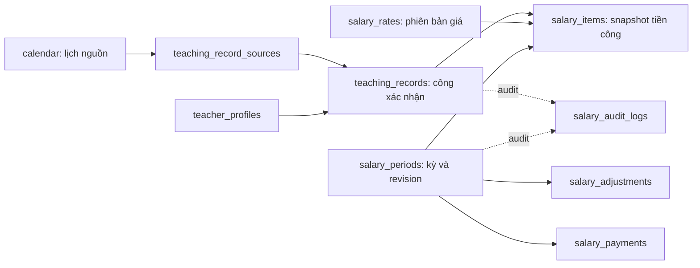
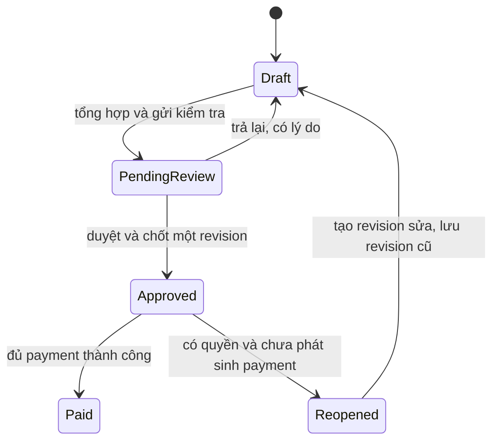

# Phân tích Phase 1 — Báo cáo giảng dạy và tính lương giáo viên

Ngày khảo sát: 20/11/2026, múi giờ nghiệp vụ Asia/Ho_Chi_Minh.

Trạng thái: **đề xuất để review; chưa triển khai**. Trong Phase 1 chỉ đọc source và viết tài liệu này; không sửa code, schema, migration, phân quyền hoặc dữ liệu. Không kết nối DB nguồn, không chạy migration, seed, worker hay API ghi dữ liệu. Các nhận định về dữ liệu dưới đây dựa trên source, không phải kết quả kiểm kê dữ liệu production.

## 1. Kết luận và phạm vi

Hệ thống có đủ dữ liệu lập báo cáo **lịch được phân công**. Chưa có nguồn xác nhận công, người dạy thực tế, đơn giá hoặc kỳ lương để tính lương đáng tin cậy. Không nên lấy `end_time < now` làm bằng chứng đã dạy, hoặc lấy số dòng lịch/room/webhook làm số công lương.

Đề xuất bổ sung một module riêng với ba lớp:

1. Báo cáo lịch: đọc các bảng hiện có, giữ nguyên nghiệp vụ lịch.
2. Xác nhận công: nhận diện nhân sự, đối soát lịch thay thế/dạy chung, xác nhận kết quả và thời lượng thực tế.
3. Bảng lương: áp đơn giá có phiên bản, tạo snapshot, duyệt/chốt/thanh toán với audit và giao dịch DB.

Không tự động xác nhận công lịch cũ. Không tự sinh giá mặc định khi chưa có cấu hình. Không tự chuyển trạng thái lịch hiện tại thành trạng thái lương.

### 1.1. Phiên bản source được khảo sát

| Thành phần | Phiên bản | Vai trò trong phân tích |
|---|---|---|
| BE `lms-manage-api` | `main`, commit `357e744` | Nền nghiệp vụ hiện tại |
| FE `LMS.FE` | `main`, commit `1347e0a` | Nền giao diện hiện tại |
| BE nhóm nhỏ | nhánh `feature/learning-groups`, commit `4a6b56e` | Phần mở rộng đã push, chưa merge vào main |
| FE nhóm nhỏ | nhánh `feature/learning-groups`, commit `5a97167` | Giao diện nhóm nhỏ tương ứng, chưa merge vào main |

Trong lần khảo sát này cả hai working tree đang ở `main`. Không checkout, merge hay đưa thay đổi nhóm nhỏ vào main. Phần nhóm nhỏ được đọc qua Git để thiết kế tương thích, không được mô tả như đã có trên main. Database local từ công việc trước có thể đi trước schema main; Phase 2 phải kiểm tra lịch sử migration trên đúng môi trường đích.

### 1.2. Những quyết định cần review trước Phase 2

| Vấn đề | Đề xuất mặc định | Chưa thể suy ra từ source |
|---|---|---|
| Đã dạy thành công | Người có quyền xác nhận công sau khi buổi kết thúc | Ai xác nhận, có cần GV xác nhận trước không |
| Giờ trả lương | Cấu hình theo giờ lịch hoặc giờ thực tế đã xác nhận; hai chỉ số luôn tách biệt | Mức làm tròn, tối thiểu, trần, trả phần vượt giờ |
| Học bù | Buổi thay thế, trả khi đã hoàn thành; buổi hủy gốc không có tiền dạy | Có phụ cấp hủy/nghỉ riêng không |
| Dạy thay | Trả người dạy thực tế; mặc định dùng cấu hình của người đó | Trường hợp dùng đơn giá người được thay |
| Dạy chung nhiều chương trình | Một công giảng thực tế, nhiều lịch nguồn; không nhân tiền theo số chương trình | Có phụ cấp theo quy mô/lớp không |
| Trợ giảng | Có báo cáo riêng theo vai trò; chỉ có tiền khi có rate được cấu hình | Có đưa TG vào cùng quy trình trả lương ngay không |
| Feed/event/phaken/topuni | Báo cáo có bộ lọc; chỉ trả khi chính sách/rate cho phép | Hệ và nguồn nào nằm trong phạm vi trả lương |
| Lớp trên 1–n | Ghi rõ “chương trình 1–n”; chưa có thực thể lớp hành chính | Có cần bổ sung danh mục lớp hành chính không |
| Kỳ đã Paid | Bất biến; sửa sai bằng khoản điều chỉnh có liên kết kỳ cũ | Quy trình duyệt điều chỉnh và thu hồi tiền |
| Giáo viên tự xem | Chưa mở mặc định; chỉ bật sau khi xác lập account–profile chính xác | Tài khoản GV đăng nhập ở LMS admin hay hệ khác |

Những mặc định này là **đề xuất**, chưa phải chính sách đã được người dùng duyệt. Phạm vi là tính tiền công giảng dạy trước thuế/khấu trừ khác; chưa tự bổ sung thuế, bảo hiểm, hợp đồng hay giao dịch ngân hàng.

## 2. Kiến trúc và các nguồn sự thật hiện tại

BE dùng Express + TypeScript, Prisma/MySQL; tách module route/controller/service. `src/app.ts` mount các module, xử lý lỗi chung bằng `ApiError`; JSON BigInt được serialize thành chuỗi. FE dùng Next.js App Router, React, Ant Design, Zustand, SWR; đã có `@ant-design/charts`, `xlsx-js-style` ở BE và các component bảng/bộ lọc dùng lại được.

| Nguồn đã đọc | Nội dung được xác minh |
|---|---|
| [schema.prisma](../prisma/schema.prisma) | Calendar, nhân sự, lessons, mapping, log, RBAC; chưa có bảng lương/công |
| [app.ts](../src/app.ts), [server.ts](../src/server.ts) | API `/api/...`, các worker tự khởi chạy khi start server |
| [livestream.route.ts](../src/modules/livestream/livestream.route.ts) | Quyền lịch, phân công, export, scope chương trình |
| [livestream.service.ts](../src/modules/livestream/livestream.service.ts) | Tạo/sửa/bulk/nghỉ/bù/dời chuỗi/swap/xóa/khôi phục, key, audit thời gian |
| [calendar-lifecycle.ts](../src/modules/livestream/calendar-lifecycle.ts), [prisma.ts](../src/lib/prisma.ts) | Soft delete, tái sử dụng key, middleware ẩn lịch xóa |
| [lesson.repository.ts](../src/modules/lessons/lesson.repository.ts) | Đồng bộ đề cương xuống lịch, đổi môn/tên/reorder |
| [teacher-profile.service.ts](../src/modules/teacher-profiles/teacher-profile.service.ts), [validation](../src/modules/teacher-profiles/teacher-profile.validation.ts) | Danh tính nhân sự, ngừng hoạt động, cấm đổi username |
| [calendar-user-sync.service.ts](../src/modules/livestream/calendar-user-sync.service.ts) | Resolve giáo viên, parse trợ giảng, enrollment/phòng |
| [calendar-room-report.service.ts](../src/modules/livestream/calendar-room-report.service.ts) | Cửa sổ phát sóng, báo cáo theo room/session, loại staff khỏi học viên |
| [calendar-detail-report.service.ts](../src/modules/livestream/calendar-detail-report.service.ts) | Hạn chế của presence log; chưa tính được số phút hiện diện chính xác |
| [evg-recordings.service.ts](../src/integrations/evg-recordings.service.ts) | Nguồn giờ bản ghi EVG, gộp khoảng, cache/lỗi API |
| [dashboard.service.ts](../src/modules/dashboard/dashboard.service.ts), [calendar-column-filters.ts](../src/modules/livestream/calendar-column-filters.ts) | “Completed” hiện là trạng thái suy ra theo lịch |
| [auth.middleware.ts](../src/modules/auth/auth.middleware.ts), [authorization.service.ts](../src/services/authorization.service.ts) | Session/JWT, quyền chức năng, scope chương trình theo tài khoản |
| [field-permission.service.ts](../src/modules/roles/field-permission.service.ts) | Chính sách visible/editable theo module/trường |
| [FE schedule](<../../LMS.FE/app/(admin)/schedule/page.tsx>), [dashboard](<../../LMS.FE/app/(admin)/dashboard/page.tsx>), [teacher-profiles](<../../LMS.FE/app/(admin)/teacher-profiles/page.tsx>) | Pattern giao diện, quyền, bảng, lọc, thông tin buổi gốc |
| [FE SideMenu](../../LMS.FE/components/layouts/AdminLayout/SideMenu.tsx), [permissions](../../LMS.FE/types/permissions.ts), [authStore](../../LMS.FE/stores/authStore.ts) | Menu theo quyền, ngữ cảnh chương trình, cache theo phiên |

Các file `.orig`, bản recovery, `dist` không được dùng làm nguồn xác định hành vi đang chạy. `prisma/schema/rbac.prisma` là file tham khảo bổ sung; schema chính được khảo sát là `prisma/schema.prisma`. Không suy ra trigger production đã được cài từ file SQL: file `prisma/sql/calendar_triggers.sql` hiện chứa các câu lệnh trigger được comment; phải kiểm tra installation thực tế ở Phase 2 bằng truy vấn chỉ đọc.

## 3. Database hiện tại và ý nghĩa nghiệp vụ

### 3.1. Bảng `calendar`

| Field thật | Ý nghĩa và hệ quả cho báo cáo/lương |
|---|---|
| `id` unsigned int | ID bản ghi lịch; khóa truy vết chính đến buổi nguồn |
| `session_id` nullable BigInt | ID bài nội bộ `lessons.id`; không phải session phát sóng |
| `code` varchar(30) | Mã chương trình; giữ nguyên ý nghĩa, không đổi thành mã nhóm/lớp |
| `learn_number`, `lesson_count` | Số bài và lần/buổi của bài; key dùng `lesson_count + 1` cho hậu tố B |
| `subject`, `lesson_name` | Nhãn môn/tên bài; có thể được đồng bộ lại từ đề cương |
| `teacher` varchar(150) | Chuỗi giáo viên; luồng tạo chuẩn hóa sang display name khi có hồ sơ |
| `assistant_teacher` varchar(500) | Danh sách username phân cách dấu phẩy; cần parse, trim, deduplicate |
| `start_time`, `end_time` | Mốc theo lịch; DB lưu giờ Việt Nam dạng wall-clock |
| `lesson_status` nullable tinyint, default 0 | Code xử lý `1` là nghỉ/hủy; `NULL`/khác 1 là lịch không bị hủy, không phải đã hoàn thành |
| `cancel_reason`, `lesson_noti` | Lý do và thông báo; văn bản tự do, không có mã nguyên nhân GV nghỉ |
| `key` nullable unique | Key đồng bộ HMO; có thể chuyển giữa các row khi học bù/dời chuỗi hoặc được tái sử dụng |
| `system_type` | `topclass`, `event`, `phaken`, `topuni`; không phải mô hình 1–n/nhóm nhỏ |
| `evg_stream`, `channel_name`, `lesson_link` | Cấu hình stream/kênh; không chứng minh người thực dạy |
| `student_synced_at` | Đã đồng bộ học viên, không phải xác nhận công |
| `deleted_at` | Xóa mềm; lịch xóa bị ẩn ở phần lớn Prisma delegate qua middleware |
| `created_at`, `updated_at` | Timestamp vận hành; không phải đầy đủ lịch sử chỉnh sửa hoặc version nghiệp vụ |

Trên main chưa có `actual_teacher_id`, `actual_start_time`, `actual_end_time`, cờ dạy thay, trường xác nhận hoàn thành, cờ đủ điều kiện trả lương hay trạng thái lương trên calendar. Không thêm các trạng thái lương vào `lesson_status`.

### 3.2. Giáo viên, trợ giảng và tài khoản

`teacher_profiles` có `id`, `username` unique, `display_name`, `can_view_stream_key`, `teacher_type`, `status`, `student_hmid` và metadata đồng bộ HMO. API/UI dùng `can_view_stream_key = 1` cho GV, `0` cho TG; không dùng `teacher_type` để tự định nghĩa lại vai trò trả lương.

Không có FK từ `calendar.teacher` đến `teacher_profiles.id`. `normalizeTeachingAssignments()` khi tạo lịch resolve username hoặc tên duy nhất rồi **lưu display name vào teacher**; TG lưu username. Khi cập nhật, `normalizeTeachingAssignmentsForScheduleUpdate()` chủ yếu chuẩn hóa chuỗi và không bắt buộc đối chiếu hồ sơ tại bước đó. Vì vậy phép JOIN `calendar.teacher = teacher_profiles.username` sẽ thiếu dữ liệu; JOIN theo tên có thể gán sai khi trùng tên hoặc đã đổi tên.

Resolver đồng bộ hiện chỉ xét profile active và đúng quyền stream, nên không dùng nguyên resolver này cho báo cáo lịch sử: người đã nghỉ việc vẫn phải xuất hiện. Module mới cần ưu tiên bằng chứng snapshot/username xác định duy nhất, sau đó tên xác định duy nhất trên toàn bộ hồ sơ phù hợp; không xác định được thì đưa vào hàng chờ đối soát, không lấy người đầu tiên.

`users` vừa có tài khoản dùng RBAC vừa có enrollment GV/TG/học viên theo chương trình/bài/phòng. `users.id` không thay được ID nhân sự để tính lương. Dùng `teacher_profiles.id` làm người hưởng lương; snapshot username/tên tại lúc xác nhận/chốt. Không lấy `users.name`/`student_hmid` làm khóa duy nhất người nhận lương. API hiện cấm đổi username nhân sự; xóa profile bị chặn nếu đang được dùng trong lịch chưa xóa, nhưng chưa biết đến bảng công/lương mới: Phase 2 cần FK RESTRICT bảo vệ cả lịch sử lương.

### 3.3. Chương trình, môn, khối và lớp

- `lessons.subject_code` là mã chương trình; `subject_name` là nhãn môn/chương trình, `grade` là khối. Unique hiện tại là `(subject_code, learn_number)`.
- `calendar.session_id` liên kết bài nội bộ theo nghiệp vụ; legacy fallback bằng `(code, learn_number)`. Main không khai báo Prisma relation/FK calendar–lesson; phải có phương án khi bài không còn hoặc sai liên kết.
- `lesson_course_mapping.lesson_id` là ID bài nội bộ. `package_lesson_mapping.lesson_id` là ID Lesson HMO; mapping theo `package_lesson_mapping.key = calendar.key`. Không dùng HMO Lesson ID làm khóa công hoặc suy ra thêm buổi dạy khi có nhiều package.
- Không có danh mục subject ID hay lớp hành chính trên main. Không tự thêm điều kiện `subject_id`/`class_id` tưởng là FK sẵn có. `grade` là khối, không phải lớp A/B; `channel_name` là kênh, không phải lớp.
- `users.class_id`, `stream.class_id`, `room_id`, `classroom_assignment_history` phục vụ phòng/enrollment. Một buổi 1–n có nhiều room vẫn là một lần GV giảng; không nhân công theo số room.
- Bộ lọc trên main có thể dùng `code`, môn từ lessons/nhãn legacy và `grade`. Chỉ số “lớp” của 1–n cần ghi rõ đơn vị thay thế là chương trình; không quảng cáo đó là số lớp hành chính chính xác.

Ở nhánh nhóm nhỏ đã có `program_settings`, `learning_groups`, `calendar.group_id`, `users.calendar_id`, `calendar.group_room_config`. Sau khi phần này được tích hợp, lọc lớp/nhóm theo `learning_groups.id`; snapshot `group_code`, tên nhóm và mô hình. Nhóm A/B cùng bài khác ngày là các buổi riêng. Nhóm khác nhau trùng giờ không tự có nghĩa là dạy chung. Key legacy giữ nguyên; key nhóm thêm `_G<id>` nhưng vẫn không dùng key làm ID trả lương bất biến.

### 3.4. Bằng chứng, log và audit sẵn có

| Bảng/nguồn | Dùng được | Giới hạn |
|---|---|---|
| `calendar_change_logs` | `operation_id`, action, actor, reason, before/after/affected snapshots; đối chiếu học bù/dời/xóa/restore | Không phải ledger lương; không chứng minh mọi thay đổi GV đều có audit độc lập |
| `evg_callbacks` | Mở/đóng stream, `live_session_id`, kênh, thời điểm | Không có danh tính GV thực dạy; một kênh có thể tái sử dụng/nhiều phiên |
| EVG recordings API | Khoảng phát sóng và trạng thái lỗi/no_stream/empty | API đang gộp min-start/max-end trong ngày, có thể bao gồm khoảng nghỉ; không dùng trực tiếp thành giờ trả lương |
| `users_logs`, `users_logs_history` | Log hoạt động theo username/code/bài/time/session | Không có đầy đủ join/leave để chứng minh giờ dạy; không có calendar_id/group_id trên log này |
| `learning_count_daily_cache` | Chỉ số học theo user/package/ngày | Không phải bảng chấm công GV |
| `hocmai_sync_queue`, Teams outbox/history | Vết tích đồng bộ/thông báo | Gửi thành công hay đồng bộ HMO không có nghĩa buổi được thực hiện |

Các báo cáo hiện tại chủ yếu phục vụ học viên/phòng. `DETAIL_LIMITATIONS` trong detail report đã nói rõ không xác định chính xác giờ rời lớp, số phút hoặc reconnect; nhiều báo cáo còn chủ động loại staff khỏi roster học viên. Không biến chuyên cần học viên (`islearn`, hai status=2) thành điều kiện đủ để trả lương GV.

## 4. Luồng lịch và tác động tới công/lương

### 4.1. Tạo, sửa, import, đề cương

`createSingle`, `createBulk`, auto-schedule và các luồng import tạo calendar, hydrate bài/chương trình, sinh key, kiểm tra trùng lịch, mapping và đồng bộ ngoài. `updateSchedule`/`updateBulk` cập nhật theo các điều kiện hiện có. Thao tác trên lịch đã bắt đầu/nghỉ bị chặn, ngoại lệ chủ yếu là mapping HMO. `allow_past` không tự bỏ qua bảo vệ sửa lịch cũ; có test `calendar-past-mapping.test.ts` cho điều này.

`auditTimeChange()` ghi `time_update` khi giờ thay đổi; đổi riêng teacher không tự có một log phân công tương đương. Teams update/outbox không nên dùng làm nguồn audit nhân sự chính thức. Import/bulk, cập nhật đề cương và sửa ngoài ứng dụng cũng phải được xét khi kiểm tra coverage audit.

`syncCalendarsFromLessons()` có thể cập nhật subject/tên bài/session_id của lịch chưa xóa, kể cả lịch quá khứ. Đổi tên môn/chương trình/reorder cũng có luồng SQL riêng. Do đó lương phải giữ snapshot môn, bài, grade, key và đơn giá đã áp; join nhãn hiện tại chỉ để tham khảo. `updated_at` đổi vì nội dung không liên quan không nên tự làm mất xác nhận công; cần fingerprint theo đúng các trường nghiệp vụ trọng yếu.

### 4.2. Nghỉ/hủy, học bù, dời chuỗi, swap

| Thao tác thật | Hành vi đã đọc trong service | Quy tắc báo cáo/lương đề xuất |
|---|---|---|
| `cancelWithoutMakeup` | Row cũ chuyển `lesson_status=1`, ghi lý do/thông báo | Vẫn thống kê hủy; chưa đủ để kết luận GV nghỉ; tiền dạy bằng 0 |
| `cancelWithMakeup` | Row nghỉ đổi key sang key hủy, tạo row bù mới giữ key hoạt động gốc; copy mapping | Row cũ không trả tiền dạy, row bù phải xác nhận sau khi kết thúc |
| `rescheduleFollowing` | Row nguồn nghỉ; nội dung/key/bài được đẩy xuống các slot tiếp theo; tạo slot cuối mới | ID slot không giữ nguyên ý nghĩa bài; fingerprint/snapshot cũ phải được kiểm tra lại |
| `makeup_after_cancel`, `following_after_cancel` | Dựa vào latest cancel log và snapshot để tiếp tục xử lý | Truy nguồn qua operation/affected snapshots; không suy từ tên bài có chữ “bù” |
| `swapSessionTimes` | Hoán đổi thời gian hai lịch trong giao dịch và audit thời gian | Không tạo thêm công chỉ vì có hai log; xét trạng thái lịch cuối |
| `updateBulk` đánh dấu ngày nghỉ | Có `mark_as_holiday`, `cancel_reason='Ngày nghỉ'` | Không quy mọi row status=1 là GV xin nghỉ; thiếu phân loại thì “chưa rõ nguyên nhân” |

Với lịch legacy không có audit đủ để xác định buổi bù, trả `session_kind=unknown` và yêu cầu đối soát; không dựa vào `_huy`, tên bài, reason tự do để tự quyết trả tiền. Buổi phát sinh thực sự phải được xác nhận là công độc lập, có lý do; mặc định học bù là thay thế.

### 4.3. Xóa mềm và khôi phục

`deleteSession` khóa row, kiểm tra lịch còn được sửa, set `deleted_at`, ghi log lifecycle và queue. Prisma middleware tự ẩn row xóa trong các delegate thông dụng; raw SQL không được bảo vệ tự động. Báo cáo mới phải ghi `deleted_at IS NULL` rõ ràng ở SQL và không dùng các log/delete event làm nguồn cộng công.

Restore có hai tình huống: khôi phục chính row nếu key chưa bị chiếm; hoặc tạo lịch mới tái sử dụng key đã xóa. `claimDeletedCalendarKey()` có thể giải phóng key row xóa, giữ lịch sử. Vì vậy `calendar.key` và HMO Lesson ID không đủ để chống trả trùng. Khôi phục theo luồng hiện tại còn kiểm tra buổi chưa diễn ra và đề cương tương thích; không mô tả như hiện có thể tự do khôi phục lịch quá khứ.

Nếu phát hiện lịch liên quan kỳ đã chốt bị sửa/xóa bởi công cụ khác: giữ nguyên snapshot tiền, thêm cờ chênh lệch để xử lý điều chỉnh; không sửa bảng lương âm thầm và không tự restore calendar.

### 4.4. Trường hợp dạy chung đặc biệt đã có

`isSharedStaffSession()` cho phép bỏ qua trùng GV/TG khi request bật boolean `allow_shared_staff_schedule=true`, hai chương trình khác nhau, tên bài chuẩn hóa giống nhau và mốc đầu/cuối giống nhau đến phút. Có test `shared-staff-schedule.test.ts`. Điều kiện này có thể cho ba chương trình trở lên cùng một GV/TG.

Cờ này không phải field bền vững trên calendar; không thể truy vấn cờ để biết chắc lịch sử nào là dạy chung. Cần phát hiện các cặp ứng viên bằng dữ liệu thực, rồi quản lý xác nhận gộp. Không tự gộp chỉ vì cùng tên/giờ/teacher; cũng không mặc định trả đủ tiền từng row.

Đề xuất một **bản ghi công cho một người trong một lần giảng thực tế**, liên kết nhiều lịch nguồn khi dạy chung. Ví dụ A/B/C cùng live 19:00–20:00 của GV X: ba lịch phân công, một buổi công và một giờ giảng được xác nhận; một khoản lương cơ bản. Phụ cấp nhiều chương trình là chính sách tách riêng nếu được duyệt.

## 5. Xác định hoàn thành và thời gian

### 5.1. Giữ hai trục trạng thái độc lập

Trạng thái tiến độ hiện tại suy từ `lesson_status`, `start_time`, `end_time`: upcoming, ongoing, completed, cancelled. Dashboard còn dùng `NOW()` ở SQL; filter/service dùng `getVietnamWallClockDate()`. “Completed” có nghĩa đã hết thời gian lịch, không xác nhận đã mở live hoặc giáo viên đã dạy.

Module mới dùng tên hiển thị rõ:

- **Đã hết giờ lịch**: điều kiện theo lịch, chỉ thuộc báo cáo phân công.
- **Chờ xác nhận công**: đã hết giờ, chưa có xác nhận hợp lệ hoặc bằng chứng/danh tính còn mâu thuẫn.
- **Đã xác nhận giảng dạy**: người có quyền xác nhận người dạy, kết quả, thời lượng; có audit.
- **Không đủ điều kiện trả lương**: hủy, không diễn ra, người vắng, dữ liệu sai hoặc chưa được xác nhận.

Không thêm giá trị vào `lesson_status` hiện tại. Trạng thái xác nhận (`unconfirmed`, `confirmed`, `rejected`, `voided`) và kết quả (`completed`, `cancelled`, `teacher_absent`, `not_held`) nằm ở dữ liệu mới. Trạng thái `stale` có thể là cờ đối chiếu source fingerprint, không được coi như confirmed hợp lệ.

### 5.2. Thời lượng đề xuất

| Chỉ số | Nguồn và cách dùng |
|---|---|
| `scheduled_seconds` | Chênh lệch end-start của lịch, chưa trừ nghỉ; phải >0 |
| Giờ stream quan sát được | Khoảng callback/recording hợp lệ; chỉ là bằng chứng hỗ trợ, có cảnh báo thiếu/ghép mơ hồ |
| `actual_seconds` | Tổng các khoảng thực dạy đã được xác nhận; union khoảng chồng, loại khoảng nghỉ; không điền bằng giờ lịch khi chưa biết |
| `payable_seconds` | Sau chính sách tính giờ, mức trần/tối thiểu/làm tròn đã cấu hình; snapshot riêng với giờ thực tế |

Đề xuất cho phép người xác nhận chọn nguồn `confirmed_manual` hoặc bằng chứng EVG đã đối soát; nếu chính sách trả theo giờ lịch thì ghi rõ `duration_basis=scheduled`, không gọi đó là giờ thực tế. Có giờ thực tế chưa xác định thì trả `null`, báo số buổi thiếu dữ liệu, không đổi thành 0 làm số liệu có vẻ đầy đủ.

Nhiều webhook/phiên stream/reconnect của một lần dạy không tự thành nhiều công. `summarizeLiveRecordingRanges()` hiện lấy min/max, nên module mới cần bộ chuẩn hóa khoảng riêng nếu tính giờ thực dạy, không đổi thuật toán báo cáo cũ. Callback channel trùng, mở trước giờ/kết thúc muộn, thiếu end, live qua ngày, retry trùng, API lỗi đều cần review hoặc chính sách xác định rõ. Không gọi EVG bên trong transaction chốt lương.

### 5.3. Quy ước kỳ và múi giờ

Lịch đang lưu giờ Việt Nam dạng wall-clock serialize bằng thành phần UTC; BE có `getVietnamWallClockDate()`, FE `combineDateTime()` ghi giờ picker giữ nguyên với hậu tố Z. Không cộng UTC+7 thêm lần nữa khi đọc calendar. Audit/payment instant mới phải được quy định rõ là instant UTC, chỉ format sang giờ Việt Nam ở UI; không trộn với clock của lịch.

Đề xuất mọi preset ngày/tuần/tháng/quý/năm/custom chuyển thành khoảng `[from, to)` theo ngày Việt Nam; tuần bắt đầu thứ Hai. Kỳ 11/2026 là `[01/11/2026 00:00, 01/12/2026 00:00)`. Xếp một buổi theo ngày bắt đầu của lần dạy cuối cùng; buổi qua nửa đêm thuộc kỳ chứa thời điểm bắt đầu, không cắt thành hai buổi. Buổi phải thực sự kết thúc trước khi xác nhận, dù nằm trong kỳ đang mở. Số giờ biểu đồ theo ngày có thể phân bổ giao ngày nhưng không thay số công/tiền theo kỳ.

## 6. KPI, bộ lọc và báo cáo chi tiết

### 6.1. Grain và định nghĩa

Phân biệt ba đơn vị: **lịch phân công**, **công thực tế của một người**, **dòng tiền của một kỳ**. Không SUM một JOIN calendar × assistants × rooms × mappings × callbacks. Aggregate từng nguồn theo đúng grain trước khi join. Tổng chung buổi phân công dùng distinct calendar; tổng theo người dùng distinct `(calendar_id, nhân_sự, vai_trò)`. Tổng công của giáo viên và trợ giảng cộng lại không bằng số buổi của hệ thống.

| KPI | Định nghĩa đề xuất |
|---|---|
| Tổng buổi phân công | Số lịch nguồn chưa xóa trong kỳ của người/role; các lịch hủy vẫn có để đối soát |
| Đã dạy thành công | Số bản ghi công `confirmed + completed` có source hợp lệ, distinct ID công |
| Chưa diễn ra | Lịch không hủy, start > thời điểm báo cáo |
| Đang diễn ra | Lịch không hủy, start <= now < end; không cộng vào lương |
| Bị hủy | Lịch chưa xóa có status=1 |
| GV nghỉ | Phân công có xác nhận người được phân công vắng; có thể buổi bị hủy hoặc người khác dạy thay. Không đồng nhất với mọi lịch hủy |
| Dạy thay | Công confirmed có người dạy thực tế khác người được phân công ban đầu đã xác định được |
| Học bù | Công confirmed được phân loại makeup và có quan hệ nguồn; không tính row hủy gốc |
| Giờ theo lịch | Tổng thời lượng lịch ở scope; hiển thị thêm giờ lịch hợp nhất cho trường hợp dạy chung |
| Giờ thực dạy | Tổng actual_seconds confirmed, đã gộp dạy chung/khoảng trùng; nêu số buổi chưa biết giờ |
| Cần xác nhận | Ứng viên công sau giờ kết thúc chưa confirmed hợp lệ, kèm unresolved/stale/duplicate candidates |
| Lương dự kiến | Ước tính từ dữ liệu đủ điều kiện + rate hợp lệ, chưa chốt; phần thiếu rate/confirmation phải tách và không tự ghi 0 |
| Lương đã xác nhận | Tiền snapshot kỳ Approved/Paid, theo revision được chốt |
| Chưa thanh toán | Nghĩa vụ đã duyệt trừ payment thành công và khoản bù trừ đã duyệt; không gồm lương dự kiến |

KPI dạy thay/học bù có thể giao nhau: một buổi bù do GV khác dạy là một công, không phải hai công. Dùng `session_kind` (regular/makeup/additional/unknown) và `is_substitute` độc lập, không tạo hai dòng cơ bản cho cùng công. “Tổng lương theo loại” dùng nhóm không chồng hoặc nêu rõ phân tích nhiều nhãn không được cộng các cột chồng nhau.

Nhân sự được đổi trước ngày dạy nhưng không có lịch sử phân công đủ tin cậy: chỉ biết người hiện trên lịch, chưa thể kết luận dạy thay ai. Cho phép quản lý xác nhận planned/actual và đính kèm căn cứ; không bịa lịch sử.

Để báo cáo đúng trường hợp A nghỉ nhưng B vẫn dạy thành công, lưu `planned_teacher_absent`/lý do riêng trên phân công nguồn đã xác nhận; kết quả công của B vẫn là completed. Không dùng một outcome duy nhất để vừa biểu diễn A vắng vừa B hoàn thành. Hồ sơ công đang chờ xác minh hoặc buổi không có ai dạy có thể chưa có actual teacher; chỉ bản ghi completed có actual teacher hợp lệ mới được tạo item lương.

### 6.2. Bộ lọc kết hợp

Thời gian/preset; giáo viên theo profile ID; trợ giảng theo profile ID; vai trò; `code`; môn/nhãn đã chuẩn hóa có nguồn; `grade`; `system_type`; nguồn livestream/feed; mô hình; nhóm/lớp nếu có; tiến độ lịch; kết quả và trạng thái xác nhận; loại buổi; cờ dạy thay; kỳ lương/revision.

Lọc GV và TG cùng lúc ở báo cáo lịch có nghĩa lịch phải có cả hai (AND giữa các dimension); nhiều giá trị trong một filter dùng OR. Báo cáo tiền chỉ hiển thị người hưởng lương đúng role được chọn, không tự cộng lương của TG vì đang lọc GV. Report luôn trả metadata mô tả scope/preset/time basis/data completeness và thời điểm chụp dữ liệu.

Trên main chưa có group, UI không hiển thị bộ lọc group như thể có dữ liệu; sau tích hợp nhánh nhóm nhỏ mới bật phần đó. Môn và grade lịch sử dùng snapshot đã xác nhận/chốt, có nhãn khi đang xem legacy fallback. Tổng lớp của một GV tách nhóm nhỏ, chương trình 1–n và số liệu không xác định.

### 6.3. Chi tiết giáo viên

Hồ sơ ID/username/tên, khoảng kỳ, số chương trình/nhóm/môn, các KPI trên, biểu đồ theo ngày, bảng buổi, bảng lương theo vai trò/loại và audit điều chỉnh. Bảng buổi gồm calendar ID và các lịch liên quan (nếu dạy chung), ngày, code, môn, khối/nhóm, lesson nội bộ, lần học, planned/actual teacher, loại/cờ dạy thay, scheduled/actual/payable duration, trạng thái, nguồn chứng cứ, rate, tiền và ghi chú.

Liên kết lịch gốc dùng route `/schedule?program=<code>&calendar_id=<id>` theo convention FE hiện có; nhiều lịch nguồn có danh sách link. Nếu row đã xóa hoặc người xem không có quyền lịch, vẫn xem được snapshot lương trong scope của họ; không vượt quyền bằng link và không coi 404 lịch hiện tại là mất lịch sử tiền.

## 7. Xác nhận công và chống tính trùng

### 7.1. Luồng đề xuất

1. Đọc ứng viên từ calendar chưa xóa và audit lifecycle, không tạo hay sửa lịch.
2. Resolve nhân sự; các trường hợp thiếu/trùng tên/legacy không rõ đưa vào issue list.
3. Xác định quan hệ bù/dời qua log thực; phát hiện dạy chung và khoảng chồng của cùng người.
4. Người có quyền xác nhận kết quả, người dạy thực tế, loại buổi, thời lượng và bằng chứng. GV chỉ có thể gửi đề nghị nếu sau này mở quyền; không tự chốt công/lương.
5. Ghi công và lịch nguồn trong một transaction, lưu source fingerprint, actor, reason, version và audit.
6. Chỉ công hợp lệ, đã kết thúc, confirmed/completed mới vào dòng lương. Rate thiếu/mơ hồ, source thay đổi, thiếu giờ theo policy thì không được chốt.

Mặc định một calendar có một slot giáo viên chính; mỗi TG là một participant slot riêng. Một người không được nhận hai suất teacher/TG cho cùng lần thực dạy nếu chưa có chính sách được duyệt. Dạy chung một người liên kết nhiều calendar vào cùng bản ghi công. Không tự hỗ trợ hai GV thay nhau giữa buổi bằng hai suất nguyên buổi: cần xác nhận segment/chia tỷ lệ, kiểm tra tổng tỷ lệ và thời gian; nếu chưa triển khai mô hình segment thì chặn chốt trường hợp này để review.

### 7.2. Định danh và điều kiện bất biến

- ID bản ghi công mới là định danh tiền công. Calendar ID là FK nguồn. Key/HMO Lesson ID/lần học/room/callback ID chỉ là thuộc tính hoặc bằng chứng, không thay ID công.
- Mapping lịch nguồn có unique `(calendar_id, participant_key)`: participant_key `primary` cho GV chính, `assistant:<profile_id>` cho TG. Một slot không được thuộc hai bản ghi công hoạt động; đổi người chính trước khi chốt là sửa công có audit, không tạo thêm slot chính thứ hai.
- Một bản ghi công có tối đa một dòng tiền cơ bản được giữ chỗ trong các kỳ. Ràng buộc DB unique trên `salary_items.teaching_record_id`, không chỉ kiểm tra ở code.
- Preview chỉ đọc; generate/recalculate có idempotency key, revision và khóa DB. Hai worker/admin không được claim cùng công vào hai kỳ, kể cả kỳ thời gian chồng nhau.
- Các kỳ đang soạn đã claim cùng công phải báo rõ đang ở kỳ nào; chỉ release dòng draft theo thao tác có audit. Không release dòng approved/paid để lập lại kỳ khác.
- Khi source fingerprint thay đổi trước chốt, invalidate xác nhận hoặc yêu cầu reconfirm rõ ràng. Fingerprint gồm ID/key/bài/giờ/người/role/code/group/trạng thái xóa-nghỉ, phân loại nguồn và dimensions ảnh hưởng đơn giá; không chỉ lấy `updated_at`.
- Không suy toàn bộ quan hệ cũ từ key hiện tại: following có thể chuyển nội dung giữa slot và học bù chuyển key sang row khác. Đối chiếu `operation_id`, before/after/affected snapshots; trường hợp thiếu log phải xác minh thủ công.

Trường hợp học chung khác code cần chọn **chương trình chịu chi phí và rate áp dụng** một cách tường minh; không chạy mỗi chương trình một lần ra nhiều lương cơ bản. Nếu cần phân bổ chi phí nội bộ thì tỷ lệ phân bổ phải cộng 100%, không tăng số tiền thực trả. Đề xuất đưa phân bổ nhiều chương trình vào phase sau; phase đầu dùng một billing program, giữ toàn bộ source để đối soát và kiểm quyền.

### 7.3. Bảng xử lý nghiệp vụ

| Trường hợp | Báo cáo phân công | Đủ điều kiện tiền dạy |
|---|---|---|
| Hết giờ lịch, chưa xác nhận | Có, nhãn chờ xác nhận | Không chốt |
| Hoàn thành, actual teacher/duration hợp lệ, đã xác nhận | Có | Có nếu tìm được rate |
| Chưa diễn ra/đang diễn ra | Có | Không |
| Hủy/ngày nghỉ | Có | Không; khoản chính sách khác phải là adjustment được duyệt |
| GV vắng, TG/GV khác dạy thay | Có, tách người phân công và thực dạy | Người thực dạy nếu confirmed; không trả đồng thời người vắng |
| Makeup hoàn thành | Có, linked buổi gốc | Một công bù; row hủy gốc không có tiền dạy |
| Đổi giờ/dời chuỗi/swap | Theo lịch cuối và audit | Chỉ công thực tế cuối cùng hợp lệ |
| Soft delete | Không vào báo cáo công hiện tại | Không tạo tiền mới; snapshot đã chốt vẫn giữ |
| Restore | Xuất hiện lại theo trạng thái thực | Không tự xác nhận, không tự nhân đôi công |
| Nhiều rooms/packages/callbacks | Vẫn một lịch hoặc một lần giảng | Không nhân số công |
| Một người dạy chung nhiều code | Có nhiều lịch; đánh dấu chung | Một công sau xác nhận gộp |
| Cùng bài ở các nhóm độc lập | Mỗi nhóm một lịch | Công độc lập nếu thực dạy ở các thời điểm hợp lệ |
| Feed/không có stream | Có theo bộ lọc | Chỉ khi policy cho phép và có xác nhận thủ công/bằng chứng phù hợp |
| Sửa lịch sau chốt | Hiển thị chênh lệch so với snapshot | Không tự thay tiền; điều chỉnh/mở lại có audit |

## 8. Thiết kế đơn giá

Không tạo một bảng giá theo mỗi môn/GV/lớp. Một bảng rule có version, dimension nullable, khoảng hiệu lực và thứ tự ưu tiên đáp ứng các hình thức yêu cầu. Chưa cần bảng “teacher_salary_configuration” riêng nếu chỉ lặp lại teacher dimension trong rate.

### 8.1. Nội dung rule đề xuất

`salary_rates`: ID, logical rule ID/version, tên, role, teacher_profile_id?, code?, subject_key?, group_id?, grade?, system_type?, calendar_source?, teaching_model?, session_kind?, is_substitute?, pay_basis (`session`/`hour`), duration_basis, amount, currency VND, priority, valid_from/valid_to, rounding/minimum/cap policy, substitute_rate_basis (`actual`/`planned`), trạng thái và creator.

“Theo môn” hay “theo chương trình/lớp” là cách chọn rule; đơn vị trả vẫn là buổi/giờ. Tính trọn gói cả môn/tháng nếu cần sau này là pay_basis khác, không tự xem như đã được hỗ trợ.

`subject_key` là giá trị cấu hình được đối chiếu với môn đã xác nhận/snapshot, không phải FK subject_id giả định. Không tự cắt “Toán 6” thành “Toán” bằng regex để chọn giá. `group_id` chỉ có sau tích hợp nhóm nhỏ; trên main rate chỉ theo code/grade/system/môn. Grade 1–12 có thể cấu hình tập giá để đáp ứng cấp học, không thêm cột cấp học giả vào lịch.

### 8.2. Chọn rate và xử lý mơ hồ

Đề xuất lưu `priority` tường minh, UI gợi ý các mức: teacher+group > teacher+môn > teacher+code > teacher > group > môn > code > mặc định. Dimensions loại buổi/role/grade/hệ tiếp tục lọc rule. Rule giáo viên+lớp của nhóm nhỏ phải khớp cả code sở hữu nhóm.

Chọn tất cả rule còn hiệu lực tại **ngày thực dạy**, khớp toàn bộ dimension đã cấu hình; sau đó lấy priority cao nhất, rồi độ cụ thể được quy định bằng một vector dimension cố định và hiển thị được. Nếu vẫn có hai rule cùng thứ hạng thì trả `ambiguous_rate` và chặn chốt; không lấy ID mới nhất ngẫu nhiên. Khi tạo/sửa, kiểm tra xung đột khoảng hiệu lực `[valid_from, valid_to)` và preview rule thắng. Kiểm tra lại ở calculator để không chỉ dựa validation UI.

Mọi thay đổi số tiền/điều kiện tạo phiên bản mới, không sửa đè phiên bản đã tham chiếu. Hồi tố chỉ ảnh hưởng draft khi người dùng chủ động tính lại và xem diff; pending review phải trả về draft để tính lại. Phiên bản giá và toàn bộ điều kiện đã áp luôn được snapshot vào item.

### 8.3. Công thức và độ chính xác

- Theo buổi: `base = rate × số suất được duyệt` (mặc định 1 công = 1 suất).
- Theo giờ: `base = rate × payable_seconds / 3600`.
- `gross = SUM(base)`; `final = gross + allowance + bonus - penalty + signed_adjustment`.
- Tiền dùng DECIMAL/Prisma.Decimal hoặc phép tính số nguyên chính xác, không tính bằng JS float. Rate/amount đề xuất `DECIMAL(18,2)`, VND cấu hình trả đến đồng, làm tròn ở mỗi item rồi cộng tổng; chưa duyệt chính sách làm tròn thì chưa phát hành calculator chính thức.
- Snapshot input seconds, rounding policy, rate, quantity và kết quả từng bước. Ví dụ theo giờ, 90 phút × 200.000/giờ = 300.000 đồng; test thêm giây lẻ, số tiền lớn và tổng nhiều item.
- Thiếu rate là lỗi cần xử lý, không tự trả 0. Zero-rate phải là cấu hình chủ động và có lý do. Số tiền âm không âm thầm coi là đã trả: thể hiện khoản phải thu/bù trừ, cần xử lý riêng trước khi period hoàn tất.

Ví dụ dạy thay: planned A, actual B. Mặc định áp rule của B. Nếu chính sách cho dùng rate A thì lưu rõ policy/rate A trong item nhưng **payee vẫn là B**. Không đổi actual teacher để chọn giá.

## 9. Database đề xuất bổ sung

Tên dưới đây là **bảng/field đề xuất mới**, không phải những bảng đang có. Thiết kế logic cần được chốt trước khi viết migration. Đề xuất 8 bảng lõi; không tạo bảng summary theo GV nếu có thể aggregate từ item snapshot.

| Bảng đề xuất | Nội dung chính | Khóa/ràng buộc |
|---|---|---|
| `teaching_records` | Một người/role trong một lần thực dạy; primary_calendar_id, planned/actual teacher_profile_id (nullable khi chưa xác định/không có người dạy), outcome, confirmation_status, kind, substitute, actual ranges/seconds, payable inputs, proof, version, snapshot/fingerprint, người xác nhận | FK calendar/profile RESTRICT; version optimistic lock; chỉ confirmed/completed có actual teacher hợp lệ mới tính tiền |
| `teaching_record_sources` | Nhiều calendar nguồn của một công khi dạy chung; calendar_id, participant_key, raw/planned assignment, planned_teacher_absent và lý do đã xác nhận, source_snapshot/hash, operation provenance | Unique `(calendar_id, participant_key)`; FK công/calendar RESTRICT; không tái dùng slot đã chốt |
| `salary_rates` | Rule, version, dimensions, thời gian hiệu lực, số tiền/policy | Phiên bản bất biến khi được dùng; rule ambiguity phải chặn |
| `salary_periods` | Name, from/to, status, revision, calculation_id, calculation_version/hash, scope_snapshot, tổng snapshot, creator/reviewer/approver/paid timestamps | from < to; lock/version; không mặc định unique tháng vì có kỳ nửa tháng |
| `salary_items` | Một công trong kỳ: teacher/role/calendar snapshot, billing code, rate_version_id/snapshot, seconds/quantity/base_amount, công/source hashes | Unique `teaching_record_id`; FK công/period/rate; không ON DELETE CASCADE lịch sử tiền |
| `salary_adjustments` | Phụ cấp/thưởng/phạt/điều chỉnh, signed amount, teacher, billing code, period, source item/period cũ nếu hồi tố, reason/proof, status, actor | Mọi khoản có định danh và audit; không tăng/sửa trực tiếp item đã chốt |
| `salary_payments` | Từng lần đánh dấu thanh toán cho teacher trong period/revision, amount, date, reference, actor, trạng thái/reversal link | Unique idempotency/reference theo convention; payment thành công là bất biến; không delete để “hoàn tác” |
| `salary_audit_logs` | Append-only log công/rate/kỳ/item/adjustment/payment, entity/action/revision, request_id, before/after, actor, reason, thời điểm | Index entity+time/period+time; ghi cùng transaction hành động |

Ảnh chụp dữ liệu cần giữ đủ để xuất lại mà không cần join dữ liệu hiện tại: IDs, username/tên GV/TG, planned/actual assignment, code/môn/grade/system/source/group, bài/key/lần học, loại và quan hệ bù, scheduled/actual/payable duration, bằng chứng xác nhận, rate/policy/version, tiền và version calculator. `salary_periods` giữ aggregate snapshot theo người/vai trò/loại có thể lưu JSON để đối soát với SUM item, không làm nguồn độc lập tự tính lại.

Actor dùng account ID và username snapshot. FK actor có thể SET NULL khi tài khoản bị loại bỏ nhưng tên snapshot không mất; không cascade xóa audit. Profile/công/lịch đã tham chiếu tiền phải RESTRICT xóa vật lý. Không cần FK tới HMO Lesson hay API ngoài; giữ ID external trong snapshot tham khảo.

Nếu cho GV tự xem, cần xác lập mapping account–profile đáng tin cậy. Có thể bổ sung `teacher_account_bindings` (unique account_id, teacher_profile_id, actor xác minh) nếu không chứng minh được quan hệ duy nhất qua username; chưa tạo bảng này hoặc mở self API khi chưa review luồng đăng nhập GV. Không tự lấy bất kỳ enrollment row nào cùng tên để cấp quyền tiền.

Chỉ số đề xuất: teaching sources calendar_id/record_id; teaching records `(actual_teacher_profile_id, service_date, confirmation_status)`; salary items `(period_id, actual_teacher_profile_id)` và unique công; rate effective/status/dimensions; adjustments `(period_id, teacher_profile_id, status)`; payments `(period_id, teacher_profile_id, status)`; audit `(period_id, created_at)`. Cần EXPLAIN/query plan trên data volume thật trước quyết định index bổ sung vào calendar; không thêm index tùy tiện vào bảng log lớn trong Phase 1.

Mối quan hệ chính:

### 9.1. Có cần sửa bảng hiện tại?

Không cần đổi cấu trúc calendar/users/lesson/mapping để đặt trạng thái lương. Không backfill group, đổi key hoặc ghi công vào enrollment.

Phase 2 có thể cần bổ sung **điểm ghi audit phân công** ở các service ghi lịch, bao gồm bulk/import/raw SQL liên quan, sau khi review coverage; chỉ thêm audit, giữ nguyên quyền và điều kiện sửa lịch cũ. Không mở sửa teacher của lịch quá khứ để giải quyết dạy thay: xác nhận actual teacher ở module công riêng.

Nếu yêu cầu bảo đảm phát hiện mọi thay đổi lịch cả ngoài ứng dụng, service hook không đủ; phải review cơ chế CDC/audit DB với vận hành. Fingerprint bắt được chênh lệch lúc đối chiếu, không khôi phục được mọi thay đổi rồi đổi ngược lại. Không hứa audit đầy đủ cho dữ liệu lịch sử chưa được ghi nhận. Phase 1 không cài trigger hay sửa writer hiện tại.

## 10. Kỳ lương, snapshot và transaction

### 10.1. State machine

`Approved` là bước chốt số liệu chính thức. Có thể bố trí hai quyền `review` và `approve` cho kiểm tra/chốt, không cần thêm trạng thái Locked trùng nghĩa nếu không có quy trình riêng. Pending review đóng băng calculation cho người duyệt; muốn sửa công/giá/khoản phát sinh phải trả về Draft. Approved/Paid chỉ đọc snapshot. Payment một phần được hiển thị riêng, trạng thái kỳ vẫn Approved cho tới khi mọi nghĩa vụ được thanh toán hoặc bù trừ hợp lệ.

Đề xuất không mở lại trực tiếp Paid hoặc kỳ có payment thành công. Sửa sai bằng adjustment ở kỳ mới liên kết item/kỳ gốc. Nếu nghiệp vụ bắt buộc hoàn tác tiền thì cần reversal có quyền/lý do/bằng chứng và kiểm soát riêng; không chỉ đổi status từ Paid về Draft. Mở lại Approved chưa trả cần quyền riêng, lưu toàn bộ item/adjustment/tổng revision cũ vào snapshot audit trước khi thay, tăng revision và quay lại quy trình kiểm tra/chốt. Không trả tiền khi đang Reopened/Draft.

### 10.2. Preview, generate và recalculate

- Preview trả eligibility/issues/rate lựa chọn/tổng dự kiến, không ghi claim, item hoặc payment.
- Generate chỉ đưa công đã xác nhận vào kỳ đúng service date/scope; ghi các khoản loại trừ và lý do. Không bỏ âm thầm những công thiếu giá.
- Draft recalculate giữ adjustment đã nhập, hiển thị diff công/thời lượng/rate/tiền; dùng expected revision để tránh ghi đè thay đổi của người khác.
- Mặc định chặn gửi duyệt/chốt khi còn công chưa giải quyết trong scope; nếu cho loại trừ thì phải lưu danh sách loại trừ có lý do và người duyệt. Tổng item phải bằng tổng được xác nhận, không lấy số lượng giới hạn của trang hiện tại.
- Kỳ chồng ngày không nhất thiết bị cấm toàn hệ thống vì có thể khác tập GV/scope. Kiểm tra trùng công ở DB, chặn claim trùng giữa mọi kỳ. Có thể bổ sung cảnh báo kỳ thời gian giao nhau cho cùng scope.

### 10.3. Chốt an toàn

Trong một transaction có retry deadlock giới hạn: khóa period trước, rồi công/lịch nguồn theo ID tăng dần; kiểm tra quyền toàn bộ scope, trạng thái PendingReview, expected revision/calculation hash; đối chiếu nguồn còn tồn tại/không xóa/hủy, ended, xác nhận công và rate version; kiểm tra không còn issue/claim trùng và tính lại tổng từ item/adjustment snapshot; ghi Approved + approved_at/actor + hash và audit cùng transaction.

Các snapshot nguồn phải đọc nhất quán với row calendar/lesson/rate liên quan; lấy phiên bản khóa hoặc nhất quán trước khi dựng item, không chỉ khóa period mà bỏ mặc công đang sửa đồng thời. Audit/mutation công dùng cùng thứ tự khóa. Không gọi API ngoài, ghi file Excel hay gửi thông báo trong transaction. Notification nếu có đi qua outbox riêng sau commit; không tận dụng hocmai_sync_queue cho lương.

Người duyệt không chỉ có quyền trên một code trong kỳ: phải được phép trên toàn bộ source/billing scope. Nếu chỉ xem một phần thì không được approve tổng kỳ. Snapshot review có thời điểm và hash; nguồn đổi trong lúc người quản lý xem phải báo cần review lại, không chốt snapshot khác với màn hình đã duyệt.

### 10.4. Thanh toán và sửa sai

Payment là **đánh dấu khoản đã trả bên ngoài**, chưa phải tích hợp ngân hàng. Khóa period + số dư người hưởng; kiểm tra Approved, amount > 0 và không vượt dư còn phải trả; lưu payment/reference/idempotency + audit; cập nhật summary/Paid khi hoàn tất. Hai lần gửi cùng request trả cùng kết quả, không ghi hai giao dịch; nhiều người thao tác đồng thời không trả vượt dư.

Adjustment sau chốt không sửa item cũ: tạo đề nghị khoản chênh lệch, duyệt và gắn kỳ điều chỉnh mới. Sai người hưởng cần khoản giảm cho người cũ và tăng cho người đúng, có liên kết cùng case; việc thu hồi/thanh toán vẫn được ghi riêng. Không trừ âm vào kỳ Paid để khiến lịch sử thể hiện như chưa từng trả.

## 11. API đề xuất

Module BE mới dưới `/api/teacher-reports` và `/api/salaries`, convention `{success:true,data:...}`; danh sách trả pagination/total/sort/metadata nhất quán. Tách service đọc nguồn, xác nhận công, chọn rate/calculator, state machine kỳ, payment và workbook. Không đặt thuật toán tiền trong controller hoặc FE.

| Nhóm | Endpoint dự kiến | Mục đích |
|---|---|---|
| Báo cáo | `GET /teacher-reports/overview` | KPI, biểu đồ, completeness, cảnh báo |
| Báo cáo | `GET /teacher-reports/teachers` | Aggregate nhân sự có phân trang/sort |
| Chi tiết | `GET /teacher-reports/teachers/:id` | Hồ sơ, KPI, phân rã loại buổi |
| Chi tiết | `GET /teacher-reports/teachers/:id/sessions` | Bảng buổi phân trang, link nguồn |
| Công | `GET /teacher-reports/teaching-records` | Công/ứng viên và issue list |
| Công | `POST /teacher-reports/teaching-records/confirm` | Xác nhận người dạy, nguồn, thời lượng/loại, expected hash |
| Công | `POST /teacher-reports/teaching-records/:id/revise` | Sửa/thu hồi xác nhận trước chốt, reason + expected version |
| Giá | `GET/POST /salaries/rates` | Danh sách/tạo rule version |
| Giá | `POST /salaries/rates/:id/versions` | Phiên bản mới, không update phiên bản đã dùng |
| Giá | `POST /salaries/rates/resolve-preview` | Giải thích rate thắng/xung đột |
| Kỳ | `GET/POST /salaries/periods` | List/tạo kỳ và scope |
| Kỳ | `GET /salaries/periods/:id` | Snapshot, revision, tổng, blockers |
| Kỳ | `GET /salaries/periods/:id/teachers` | Tổng từng người; phân trang |
| Kỳ | `GET /salaries/periods/:id/items` | Chi tiết snapshot; filter/sort |
| Kỳ | `POST /salaries/periods/:id/preview` | Chỉ đọc, so sánh đầu vào |
| Kỳ | `POST /salaries/periods/:id/recalculate` | Lưu draft, idempotency + version |
| Điều chỉnh | `POST /salaries/periods/:id/adjustments` | Khoản phát sinh/điều chỉnh có reason/proof |
| Duyệt | `POST /salaries/periods/:id/submit-review` | Draft → PendingReview |
| Duyệt | `POST /salaries/periods/:id/return` | PendingReview → Draft, lý do |
| Chốt | `POST /salaries/periods/:id/approve` | Review/chốt revision transaction |
| Mở lại | `POST /salaries/periods/:id/reopen` | Approved chưa trả → revision điều chỉnh |
| Trả tiền | `GET/POST /salaries/periods/:id/payments` | Lịch sử/ghi nhận thanh toán |
| Audit | `GET /salaries/periods/:id/history` | Lịch sử, diff, actors trong scope |
| Export | `GET /teacher-reports/export`, `GET /salaries/periods/:id/export` | Excel báo cáo/live hoặc snapshot kỳ cụ thể |

Filter định dạng ngày `YYYY-MM-DD`, khoảng half-open, ID/profile/group phải có thật và đúng scope, page >=1/limit <=100, sort theo allowlist + ID tie-break, không truyền tùy ý tên cột SQL. Endpoint time-series dùng cùng filtered dataset, không lọc riêng khác tổng. Unknown status/type trả 400. Tiền không nhận trực tiếp ở endpoint approve; server dùng snapshot đã tính.

Mutation nhận `expected_version`/`calculation_hash`, `idempotency_key` khi thích hợp và reason bắt buộc. Các lỗi expected: 400 validation, 401/403 quyền, 404 trong scope, 409 stale/claimed/invalid transition/ambiguity, 422 dữ liệu chưa đủ. Không dùng GET để thay state; không trả HTTP 200 nhưng thay dữ liệu một phần khi recalculate thất bại.

## 12. Phân quyền và dữ liệu nhạy cảm

Hiện có `roles`, `permissions`, `role_permissions`, `user_roles`; scope PROGRAM được lấy từ policy/binding **tài khoản** qua `scope_resources`, không suy từ nhãn role. Admin có `*`; non-admin mặc định DENY nếu thiếu scope. `authorize([...])` có nghĩa **OR**, nên nếu cần hai quyền bắt buộc phải dùng hai middleware hoặc kiểm tra AND rõ ràng, như detail-report router đang làm.

Quyền mới đề xuất (chưa seed, chưa gán):

| Permission | Ý nghĩa |
|---|---|
| `teaching_report.view` / `teaching_report.export` | Xem/xuất khối lượng, không kèm tiền |
| `teaching_record.confirm` / `teaching_record.revise` | Xác nhận/sửa công có audit |
| `salary.view` | Xem tiền trong scope; không tự có quyền sửa giá/chốt |
| `salary.rate.manage` | Cấu hình phiên bản giá |
| `salary.period.create` / `salary.period.calculate` | Tạo kỳ/tính draft |
| `salary.adjust` | Tạo khoản điều chỉnh |
| `salary.review` | Kiểm tra và trả/gửi duyệt |
| `salary.approve` | Chốt snapshot |
| `salary.pay` | Đánh dấu thanh toán |
| `salary.reopen` | Mở kỳ Approved chưa trả |
| `salary.export` / `salary.audit.view` | Xuất lương/xem audit |
| `salary.self.view` | Tùy chọn, chỉ dữ liệu chính người đăng nhập đã được binding |

Người chỉ có teaching_report.view không được nhận rate/amount/KPI tiền trong JSON, charts, tooltips hoặc Excel; không chỉ ẩn cột FE. API tiền cần `salary.view` AND quyền hành động tương ứng AND scope nguồn/billing. Rate mặc định áp toàn hệ thống chỉ người có scope ALL và quyền quản lý giá mới được sửa; scoped manager chỉ sửa rule giới hạn trong code được cấp. Rate toàn cục không tự được liệt kê cho người chỉ có quyền xem lịch.

Kỳ nhiều code cần tách quyền xem subset và quyền hành động toàn kỳ. Không trả grand_total/teacher_count/payment/history tổng kỳ cho người chỉ thấy một phần. Bản ghi công dạy chung nhiều code cần quyền trên toàn bộ source để xác nhận/gộp; người chỉ thấy subset nhận dữ liệu đã che phù hợp, không lộ lịch ngoài scope. Adjustment không gắn code phải chỉ xuất hiện cho scope ALL hoặc phải có allocation được kiểm soát; không dùng code tùy ý để vượt scope.

Self API riêng có thể dùng `salary.self.view` thay `salary.view`, nhưng chỉ với profile từ binding được xác minh phía server; không tin `teacher_id` query. Self permission không mở các API quản trị kỳ/giá/thanh toán. Self view chỉ trả statement của mình, không danh sách GV, rate của người khác, biểu đồ toàn hệ hay audit có dữ liệu người khác. Sự thay đổi quyền phải vô hiệu cache tương ứng; SWR/cache phía server phải có namespace theo user/session/scope/permission/revision, không share response tiền giữa người dùng.

Tận dụng module/fieldPolicy hiện tại để khai báo field tiền, nhưng authorization trong service vẫn là lớp bảo vệ chính. Không để fieldPolicy mặc định mở khiến `calendar.view` thấy lương. Đề xuất tách người lập và người chốt; người có quyền không tự approve thay đổi do mình lập trừ policy ngoại lệ được duyệt và audit. Quyền mới không tự gán cho role giáo viên hay manager đang có.

## 13. UI/UX và Excel

### 13.1. Tích hợp vào LMS hiện tại

Thêm menu “Báo cáo giảng dạy” và “Bảng lương” theo PermissionKey; giữ AdminLayout, Card/Statistic/Tag/Space, CustomTable, MobileSelect, CustomSearchInput, DatePicker và pattern loading/empty/error hiện có. Dùng `@ant-design/charts` cho biểu đồ thay vì thêm thư viện mới. Không tạo dashboard khác hệ màu hoặc clone màn lịch.

Các trang dự kiến: `/teacher-reports` (tổng quan + danh sách), `/teacher-reports/teachers/[id]`, `/salaries/periods`, `/salaries/periods/[id]`, `/salaries/rates`. Có thể dùng Tabs trong chi tiết kỳ cho tổng hợp GV, chi tiết buổi, khoản điều chỉnh, thanh toán, audit. Chỉ thêm entry/link ở lịch/teacher-profile khi quyền cho phép; không sửa điều kiện tạo/sửa lịch cũ.

Tổng quan gồm KPI phân công/công/tiền tách nhãn, biểu đồ số buổi theo ngày/tháng, lương theo GV, phân bổ môn, top khối lượng và kỳ chờ duyệt. Biểu đồ tiền biến mất hoàn toàn khi không có salary.view. Dữ liệu thiếu phải có badge “Chưa xác nhận”, “Chưa xác định GV”, “Thiếu đơn giá”, “Nghi dạy chung”, “Nguồn thay đổi”; không dùng dấu 0 cho unknown.

Bộ lọc giữ URL state, scope hiện tại và thời gian; desktop nhiều cột, mobile gom vào Drawer, KPI wrap và bảng cuộn ngang. Trên trang kỳ đã chốt, banner hiển thị revision/thời điểm chốt/người duyệt/hash rút gọn; dữ liệu nguồn thay đổi có drawer so sánh, nhưng tiền snapshot không nhảy theo live query. Action calculate/approve/pay/reopen nằm riêng với quyền và điều kiện trạng thái rõ ràng; dialog cuối hiển thị số người/số buổi/tổng tiền/phiên bản và lý do, không hỏi xác nhận chung chung không có con số.

### 13.2. Export và đối soát

Workbook BE dùng `xlsx-js-style`, cùng service/query/snapshot với UI. Không export từ page đang tải trên FE và không tính lại giá khi xuất kỳ Approved/Paid. Hai loại export được gắn nhãn khác nhau: báo cáo nguồn tại thời điểm đọc, và bảng lương snapshot của period/revision.

Sheet Tổng hợp: ID/username/tên/role, số lịch nguồn, số công completed/substitute/makeup, giờ lịch/thực/payable, tiền cơ bản, phụ cấp, thưởng, phạt, điều chỉnh, tổng cuối, đã trả/chưa trả. Khi nhiều rate, ghi “nhiều đơn giá” và dùng sheet chi tiết, không đặt một rate giả cho cả tháng.

Sheet Chi tiết: record/item ID, calendar nguồn và links, ngày/code/môn/khối/nhóm, bài/lần học, planned/actual teacher, start/end scheduled/actual, duration/payable basis, loại/trạng thái, rate/version, quantity/base/final allocation, note. Thêm sheets Adjustments, Payments, Issues và Metadata (scope/filter/timezone/generated_at/period/revision/calculation hash/rounding/version).

Ô tiền và thời lượng dùng numeric format nhất quán; ID BigInt dài ghi text để Excel không mất chữ số. Text từ người dùng phải ghi dạng literal, không biến thành công thức. Tổng workbook lấy từ cùng dataset/revision và checksum với UI; export giới hạn dòng rõ ràng, nếu vượt thì báo thu hẹp hoặc dùng job export, không cắt bỏ không thông báo. Quyền export và salary.view kiểm tra lại tại tải file; job nếu triển khai phải gắn chủ sở hữu/scope và hạn dùng.

## 14. Edge case và tiêu chí test

Phase 1 chỉ kiểm tra source/tài liệu, **chưa chạy test payroll vì chưa triển khai**. Các test lịch sẵn có được đọc làm đặc tả hồi quy: `calendar-past-mapping.test.ts`, `shared-staff-schedule.test.ts`, `calendar-soft-delete.integration.ts`, `calendar-lifecycle-triggers.integration.cjs`, `calendar-detail-report-auth.test.ts`, `calendar-room-report.test.ts`, `calendar-teaching-user-revocation.test.ts`, `lesson-calendar-sync.test.ts`, `lesson-program-rename.test.ts`, tests bulk conflict/auto-schedule/import/time notifications. Không coi test fake client là bằng chứng transaction thực của module tiền.

| Ca test cần bổ sung | Kết quả chấp nhận |
|---|---|
| 1. GV dạy đủ tháng | Số công confirmed, thời lượng và tiền bằng phép tính độc lập |
| 2. Có lịch tương lai/đang diễn ra | Có phân công, không chốt tiền |
| 3. Lịch hủy | Tăng canceled; không cộng lương dạy |
| 4. GV nghỉ/ngày nghỉ | Phân biệt outcome teacher_absent và cancel nguyên nhân khác |
| 5. Dạy thay | Payee là actual teacher, người cũ không được trả đồng thời |
| 6. Học bù | Chỉ buổi bù completed được trả, liên kết gốc đúng |
| 7. Đổi lịch/following/swap nhiều lần | Không nhân công theo log/key cũ; stale confirmation được phát hiện |
| 8. Xóa lịch | Không tạo item mới; snapshot chốt không bị xóa |
| 9. Khôi phục/tái dùng key | Không claim công hai lần, giữ ID nguồn cũ/new rõ ràng |
| 10. Đổi GV trước/sau buổi | Theo quyền lịch hiện tại; thay actual sau buổi ở module công, có audit |
| 11. Nhiều lớp/nhóm | Cùng bài ở nhóm độc lập là công riêng; một lịch nhiều room không nhân công |
| 12. Nhiều môn/rate/hiệu lực | Đúng rule ưu tiên và ngày service; thiếu/trùng rule chặn chốt |
| 13. Nhiều GV trong kỳ | Aggregate đúng từng payee/role và tổng kỳ |
| 14. Recalculate draft lặp lại | Idempotent, giữ adjustment, diff rõ, không trùng item |
| 15. Sửa nguồn sau Approved/Paid | Tiền/export giữ snapshot cũ, có discrepancy |
| 16. Điều chỉnh sau chốt | Kỳ gốc bất biến, khoản +/- kỳ mới liên kết đầy đủ |
| 17. Dạy chung 2–3 code | Nhiều calendar sources, một công/tiền cơ bản sau xác nhận gộp |
| 18. Hết giờ nhưng chưa dạy/xác nhận | Chưa trở thành công trả lương |
| 19. UI–Excel–DB | Cùng scope/revision/hash, tổng khớp tới đồng |
| 20. RBAC/self/fieldPolicy | Không lộ dữ liệu người khác qua ID, summary, charts, export, audit/cache |
| 21. Hai người chốt/tính/pay đồng thời | Một kết quả hợp lệ, 409 hoặc retry đúng; không double-pay |
| 22. Hai kỳ chồng ngày | Unique claim công chặn trả trùng, kể cả khác worker |
| 23. Live qua ngày/cuối tháng/năm | Timezone và kỳ half-open đúng, không tính hai lần |
| 24. Nhiều callback/gap/thiếu end/API lỗi | Không gộp min/max thành giờ thực vô điều kiện; đưa issue |
| 25. Trùng tên/đổi tên/profile inactive | Không gán nhầm, lịch sử vẫn xem được qua snapshot |
| 26. Đổi môn/reorder/mapping sau chốt | Rate/nhãn/tiền snapshot không đổi; không nhân tiền theo package |
| 27. Partial payment/retry/overpay/reversal | Không vượt dư; không sửa/xóa giao dịch đã xác nhận |
| 28. Reopen khi đã trả | Bị chặn; dùng adjustment/reversal đúng quy trình |
| 29. Teacher và TG trùng người/multiple TG | Deduplicate đúng participant, không có hai suất vô tình |
| 30. Scope dạy chung/period nhiều code | Không approve thiếu quyền một code; không lộ grand totals |
| 31. Decimal/giây lẻ/giá 0/negative | Công thức và rounding đúng policy, unknown không thành zero |
| 32. Rollback/audit | Lỗi ở bất kỳ bước chốt không để lại approved/item/payment/audit nửa vời |

Unit test cho state machine, classification, identity ambiguity, rate resolver, interval union và money calculator; integration trên database tạm local cho FK/unique/locking/idempotency/transactions/snapshot; HTTP test quyền và scope; FE E2E cho filter, review diff, chốt/trạng thái và mobile. Dùng clock cố định trong test, không dựa giờ máy hoặc gọi HMO/EVG production.

## 15. Kế hoạch triển khai có thể review độc lập

| Phase | Deliverable | Cổng kiểm tra |
|---|---|---|
| 1 — hiện tại | Tài liệu này, khảo sát nguồn/khác biệt nhánh, vấn đề cần quyết định | Dừng để review, chưa code/DB |
| 2A — dữ liệu | Chốt định danh công và source links; migration additive cho bảng công/rate/kỳ/item/adjust/payment/audit và constraints | Test migration trên clone/tạm; không backfill confirmed hoặc sửa calendar |
| 2B — báo cáo/công | Query read-only, filters/KPI phân công, resolver legacy, đối soát bù/shared; API xác nhận công và audit | So khớp mẫu lịch thật đã được phép đọc; chưa trả tiền tự động |
| 2C — tính lương | Rate versioning/preview, decimal calculator, generate/recalculate draft, claims chống trùng | Test công thức/ambiguity/2 kỳ đồng thời |
| 2D — quy trình/API | Review/approve/reopen/pay/adjustment với locking/idempotency/snapshot/audit | Integration transaction + quyền, không ngân hàng |
| 2E — UI báo cáo | Menu, overview, danh sách/chi tiết, bộ lọc/biểu đồ/confirmation queue theo style cũ | UI/API cùng scope và KPI; mobile |
| 2F — UI lương | Rate, kỳ, draft diff, review, snapshot và payment/adjustment history | Quyền theo action, không chỉnh trực tiếp tiền chốt |
| 2G — Excel/đối soát | Summary/detail/metadata/adjustments/payments, checksum | Khớp UI–DB–Excel và snapshot |
| 2H — nghiệm thu | Toàn bộ test matrix, kiểm quyền, rollout/rollback, kiểm dữ liệu thiếu và audit coverage | Shadow run ít nhất một kỳ so với bảng công kế toán trước khi dùng chính thức |

RBAC và audit phải đi cùng mỗi API/mutation từ 2A–2D, không chờ đến cuối mới thêm. Mỗi nhánh/PR nhỏ chỉ chứa phần đã review; không tự merge main. Việc tích hợp nhóm nhỏ cần quyết định base branch rõ ràng hoặc dependency PR; không dựng migration `group_id` trùng với nhánh đã có.

Rollout đề xuất: tắt tính năng mặc định, cấp quyền thử nghiệm có giới hạn, backfill chỉ ứng viên chưa xác nhận, chạy báo cáo song song với đối soát thủ công, giải quyết unresolved/rate thiếu, sau đó mới bật chốt. Nếu rollback UI/API mới thì giữ nguyên bảng/audit/snapshot đã phát sinh; không rollback bằng cách drop bảng lương hoặc xóa lịch sử tiền.

## 16. Điều kiện kết thúc Phase 1

Tài liệu đã tách rõ sự thật từ source và chính sách đề xuất, chỉ ra dữ liệu còn thiếu để tránh tính sai/trùng; nêu schema/API/UI/RBAC/audit/test và thứ tự triển khai. Các điểm tại mục 1.2 cần được review trước khi chọn phương án Phase 2. Không có thay đổi code hoặc database nào thuộc module này được thực hiện trong Phase 1.

## 17. Triển khai Phase 2 — ngày 20/11/2026

Phần trên giữ nguyên làm hồ sơ khảo sát Phase 1. Module hiện đã được triển khai trên hai nhánh `feature/teacher-report-salary` của BE và FE, tách từ `main`; chưa merge vào `main`.

### Dữ liệu và khả năng tương thích

Migration `20261120180000_teacher_report_salary` bổ sung 8 bảng: `teaching_records`, `teaching_record_sources`, `salary_rates`, `salary_periods`, `salary_items`, `salary_adjustments`, `salary_payments`, `salary_audit_logs`. Không backfill công confirmed và không tự tạo đơn giá. Migration chỉ được áp dụng vào `livestream_local`; đối chiếu trước/sau xác nhận các bảng lịch, mapping, users, teacher_profiles, stream và room_config không đổi. Không ghi vào database nguồn.

Code đọc tùy chọn `group_id`/`learning_groups` khi môi trường đã tích hợp migration nhóm nhỏ; không tạo lại bảng nhóm và không yêu cầu merge nhánh nhóm nhỏ vào nhánh này. API lịch cũ giữ nguyên hợp đồng. Bổ sung audit khi đổi GV/TG qua luồng chỉnh lịch có actor; dữ liệu sửa trực tiếp ngoài ứng dụng vẫn cần đối soát.

### Màn hình và API

- `/teacher-reports`: lọc kết hợp, KPI công, biểu đồ ngày, lịch phân công, tổng hợp theo nhân sự, công xác nhận, liên kết lịch nguồn, đối soát dạy bù/thay/dạy chung và export.
- `/teacher-salary/rates`: đơn giá theo buổi/giờ, điều kiện nhân sự/chương trình/nhóm/môn/khối/vai trò/hệ/nguồn/loại buổi/dạy thay, ưu tiên và phiên bản hiệu lực.
- `/teacher-salary`: tổng tiền các kỳ, biểu đồ theo nhân sự, tạo kỳ, tính lại, kiểm tra, chốt, mở lại kỳ chưa thanh toán, điều chỉnh, ghi nhận thanh toán từng phần, snapshot, audit và Excel.

API nằm dưới `/api/teacher-salary`: `options`, `report`, `report/export`, `teaching-records/confirm`, `teaching-records/:id/revise`, `rates`, `overview`, `periods` và các thao tác theo kỳ `preview`, `recalculate`, `submit`, `return`, `approve`, `reopen`, `adjustments`, `payments`, `items/:itemId`, `history`, `export`. Các ngày lọc/kỳ dùng cận trên loại trừ; UI khoảng báo cáo chuyển ngày cuối người dùng chọn sang cận trên này. Giờ lịch/công dùng quy ước wall-clock Việt Nam của hệ thống; thời điểm audit/thanh toán là UTC và hiển thị UTC+7.

Migration đăng ký 15 quyền mới nhưng không tự cấp vào role hiện hữu. Quản trị cấp các quyền `teaching_report.*`, `teaching_record.*`, `salary.*` trong màn quản lý vai trò hiện tại, với phạm vi chương trình tương ứng. Quyền xem báo cáo công không đồng nghĩa quyền xem tiền; server kiểm tra lại mọi thao tác, export và toàn bộ nguồn của một công dạy chung/kỳ nhiều chương trình.

### Trình tự dùng lần đầu

1. Cấp quyền cho người đối soát công, người cấu hình giá, người lập/duyệt/ghi nhận thanh toán.
2. Đối soát danh tính và xác nhận các buổi đã thực dạy. Hết giờ lịch không tự trở thành công trả lương. Lịch nghỉ gốc không được trả lần nữa khi có học bù.
3. Tạo đơn giá có hiệu lực theo ngày công. Thiếu hoặc trùng rule sẽ chặn gửi kiểm tra/chốt, không tự áp giá 0.
4. Tạo kỳ theo chương trình, tính lại bản nháp, kiểm tra danh sách vấn đề và thêm các khoản điều chỉnh nếu cần; tính lại sau điều chỉnh trước khi gửi kiểm tra.
5. Gửi kiểm tra, duyệt/chốt rồi ghi nhận chứng từ thanh toán. Đây là ghi nhận nghiệp vụ, không thực hiện chuyển tiền ngân hàng.
6. Nếu công đã vào kỳ nháp cần sửa: loại công khỏi kỳ để đối soát rồi tính lại. Kỳ đã có thanh toán không được mở lại; điều chỉnh tại kỳ khác có liên kết dòng lương gốc.

Bảng công/lương là dữ liệu nghiệp vụ mới cần nhập xác nhận và cấu hình trước khi có tiền. Các KPI tiền nằm ở màn lương theo kỳ; không coi toàn bộ lịch tương lai là lương dự kiến. Chưa có cổng giáo viên tự xem lương, tích hợp ngân hàng hay tự suy ra giờ thực dạy từ callback. Một lần giảng được trả cho một nhân sự ở mỗi record; chia một buổi thành nhiều chặng giảng cho nhiều người cần mô hình segment riêng trước khi hỗ trợ. Không sửa rule nghiệp vụ lịch để giải quyết các trường hợp này.

### Kiểm chứng và vận hành

Đã chạy unit test domain, integration trên MySQL database tạm với migration thật, kiểm quyền qua HTTP, kiểm transaction/claim/payment đồng thời, đối chiếu Excel với tổng kỳ và hồi quy lịch hiện hữu. Kiểm tra Chrome chạy component thật với fixture API cho xác nhận công trên mobile, cấu hình giá trên mobile và duyệt kỳ trên desktop; không coi fixture UI là bằng chứng tích hợp end-to-end với production. FE build và kiểm TypeScript hai repo thành công.

Khi deploy: áp dụng migration additive sau khi backup, deploy BE/FE rồi cấp quyền giới hạn để đối soát một kỳ thử. Không dùng `db push` lên môi trường triển khai. Không sửa migration đã áp dụng; thay đổi schema tiếp theo phải có migration mới. Khi rollback ứng dụng, giữ các bảng công/lương/audit và chứng từ đã phát sinh.
